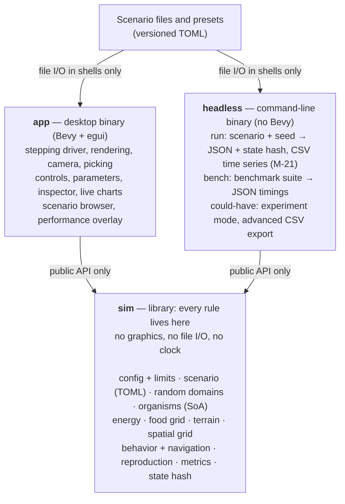
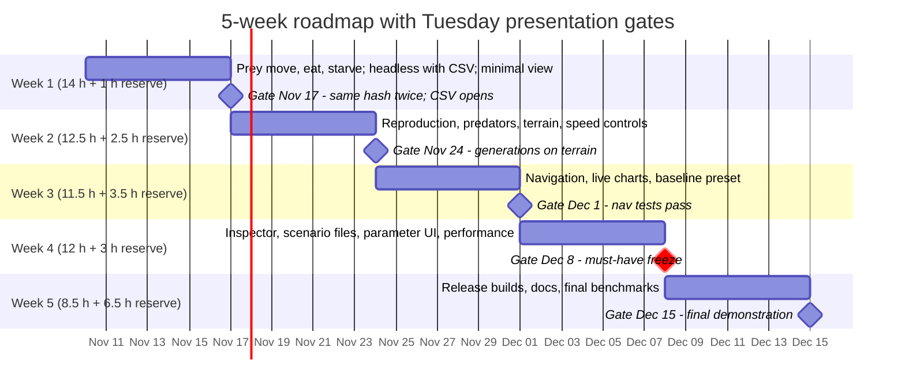

# Natural Selection Simulator — Software Scope Document

Version 2.2 · November 10, 2026 · Values marked (P) are provisional

## Document status and conventions

This is the scope of record for a 5-week, 75-hour individual build that started Tuesday, November 10, 2026.

**Implementation status.**

- **Complete:**
  - M-01.
  - The core and pure stepping-driver portions of M-02. Connecting the driver to the app waits for M-10 and M-11, and the app-versus-`headless` part of T-DET-4 waits for M-17.
  - M-03 for prey. Birth suppression at the safety cap waits for births in M-04.
  - M-07.
  - The basic, unobstructed Week 1 portion of M-09.
- **Not yet implemented:** M-17, M-21, graphical integration, reproduction, predators, terrain, navigation and scenarios.

The README tracks detailed status. Nothing beyond the completed items is claimed to work.

The must-have baseline is about 58.5 implementation hours, and 16.5 hours are held in reserve. Section 22 lists every change from versions 1.0, 2.0 and 2.1.

| Week | Build dates (2026) | Progress presentation | Must-have implementation (h) | Reserve (h) |
| --- | --- | --- | --- | --- |
| 1 | Tue Nov 10 – Mon Nov 16 | Tue Nov 17 | 14 | 1 |
| 2 | Tue Nov 17 – Mon Nov 23 | Tue Nov 24 | 12.5 | 2.5 |
| 3 | Tue Nov 24 – Mon Nov 30 (US Thanksgiving is Thu Nov 26) | Tue Dec 1 | 11.5 | 3.5 |
| 4 | Tue Dec 1 – Mon Dec 7 | Tue Dec 8 | 12 | 3 |
| 5 | Tue Dec 8 – Mon Dec 14 | Tue Dec 15 — final demonstration | 8.5 | 6.5 |
| **Total** | | | **58.5** | **16.5** |

- **Implementation hours** include writing prompts for Claude Code and a first review of what it produces.
- **Reserve hours are not optional feature capacity.** They are committed first to debugging, integration, deeper review of Claude Code output, balancing, and build problems. A should-have may start only when the four conditions in Section 4 hold.
- Presentation preparation is outside the 75 hours.
- The dates assume each week ends with the following Tuesday's presentation.

**Conventions used throughout**

- **M-xx / S-xx / C-xx / W-xx**: Must, Should, Could and Won't feature IDs (Section 4).
- **T-xx**: test IDs (Section 15). Each test is marked Must or Should.
- **(P)**: a provisional value or formula. It is a starting point for profiling or balancing, not a requirement, and may change without a scope change.
- **Tick**: one fixed simulation step. 1 simulated second = 30 ticks (P), and 1× speed = 30 ticks per real second.
- **Dev environment**: WSL2 Linux with Visual Studio Code.

**Hardware terms**

- **Reference machine**: the laptop available for benchmarking. It has an Intel Core i5 (exact model not yet recorded), 8 GB RAM, an NVIDIA RTX 4060 Laptop GPU and Windows. It is not the development machine.
- **Target hardware class**: the mid-range laptops a teacher might use. The project has no data on what classroom machines are like. Many may have integrated graphics and slower processors than the reference machine.
- The reference machine is a convenient measurement point, not a representative classroom machine; its dedicated GPU is likely stronger than typical school hardware. All performance results in this document apply to the reference machine only (open question Q14).

Implementation prompts should cite feature and test IDs. The architecture invariants in Section 7.4 belong in the repository's CLAUDE.md so every Claude Code session sees them.

## 1. Project summary and goals

The project delivers a Rust desktop application that simulates natural selection among prey and predators on procedurally generated 2D terrain. It serves two uses: classroom demonstration in high school and introductory college biology, and simple, repeatable natural-selection experiments.

Organisms find food, move, spend energy, reproduce asexually and pass three numeric traits (speed, size, sense range) to offspring with small mutations. Terrain shapes where food grows, how fast organisms move and where they cannot go. Live charts show populations and average traits changing across generations.

| ID | Goal | How it is measured |
| --- | --- | --- |
| G1 | Make the mechanisms of natural selection observable: inheritance with mutation, trait-dependent costs and capabilities, and differential survival and reproduction under predation, food and terrain pressure, shown through populations and trait averages across generations | Mechanism tests (Section 15.3), live charts, inspector, classroom criterion E2 |
| G2 | Classroom usability: a teacher can load, run, inspect and discuss a scenario within one class period | Teacher-flow manual test (E1) |
| G3 | Repeatable experiments: the same scenario and seed give identical results in the app and in `headless` | Determinism tests T-DET-1, T-DET-2, T-DET-4 |
| G4 | Measured performance on the reference machine, with roughly 50,000 organisms on a large map as the benchmark goal | Performance tiers and procedures (Section 10) |
| G5 | Honesty about the model: every simplification is documented | Model and limitations documentation (M-20) |
| G6 | Clean extension points for more traits, species and environment, without generic systems the first release does not use | Section 9 |

The professor's three interests map as follows: application performance is G4, and plausible real-world use is G1–G3. The LLM workflow is a course activity and outside this software scope.

Scientific accuracy wins where feasible. Where full realism does not fit the five weeks, educational clarity and a plain statement of the model's limits take priority over apparent realism. A working application takes priority over comprehensive infrastructure.

## 2. Target users and primary use cases

The primary users are high school and introductory college biology teachers; students and people running simple experiments are secondary users. The professor has not yet confirmed that this audience satisfies the project requirements, so it stays open as Q1 in Section 20.

| User | What they need | Served by |
| --- | --- | --- |
| High school biology teacher | Load a ready scenario, run it fast enough to see change in one period, point at individuals and charts | Presets, speed controls, inspector, charts, simple controls |
| Introductory college biology teacher | The same, plus adjustable parameters and sharable configurations | Advanced controls, scenario files |
| Student | Watch and interpret populations and trait averages over generations; inspect organisms | Charts, inspector, generation readout |
| Simplified-experiment user | Repeat a configuration with recorded seeds and get comparable numbers | Scenario files, seeds, `headless run` with CSV export |

**UC1 — Classroom demonstration in one class period (primary)**

1. Launch the app; it opens on the baseline predator–prey preset.
2. Optionally adjust simple controls: starting populations and food abundance.
3. Press Play and choose a speed (1×, 2×, 5×, 10× or Max).
4. Pause and click organisms to compare their traits with the population averages.
5. Discuss the charts: predator and prey populations and the averages of speed, size and sense range, whether they move or hold steady. If a species goes extinct, discuss why.
6. Reset with the same seed to replay, or with a new seed to show variation between runs.

**UC2 — Teacher prepares and shares a scenario.** Adjust parameters, add a name, description and learning goal, and save a scenario file. Another teacher or student loads the file and gets the same configuration.

**UC3 — Student analysis of a run.** Students observe charts and inspect organisms during or after a run. Prediction prompts and prediction comparison are out of scope (W-04).

**UC4 — Simple repeatable experiment.** Run a scenario file with a chosen seed for a fixed duration in `headless` and record the final metrics, optionally with a CSV time series sampled at a chosen interval that opens in Excel or another spreadsheet application (M-21). Re-running the same command reproduces the result exactly, byte for byte. Multi-seed experiment mode is a could-have (C-02).

**UC5 — Performance measurement (developer).** Run the benchmark suite in `headless`, and read frame-time statistics from the app's performance overlay on the reference machine.

## 3. Success definition

The release succeeds when every criterion in both tables below holds on the stated machine; values marked (P) are fixed by the end of Week 3.

**Educational use**

| ID | Criterion | Verified by |
| --- | --- | --- |
| E1 | From launch, a running baseline preset is reached in at most 3 user actions (select preset if not default, press Play, pick speed) | Manual teacher-flow test |
| E2 | **Classroom usefulness.** In at least 3 of 5 fixed seeds (seeds 1–5) (P), the baseline classroom preset, run for its target duration of 10 minutes at 10× (180,000 ticks (P)): completes without crashing or reaching the population safety cap; reaches at least prey generation 5 (P); records prey births and deaths; records successful predation; produces interpretable population and mean-trait charts; and lets the user inspect organisms from multiple generations. Extinction remains a valid result if enough activity occurs first to support classroom discussion. No minimum size or predetermined direction of trait change is required. | Counted conditions: `headless` runs over seeds 1–5. Charts and inspection: manual teacher-flow test on one of the passing seeds |
| E3 | Charts show population per species and mean speed, size and sense range per species, updating live. Mean and maximum generation per species and cumulative births, deaths and successful predations are shown as numbers. An extinction is announced in the status bar with its simulated time. | T-CHART-1, T-CHART-4 |
| E4 | Any organism can be clicked to show species, traits, energy, age and generation | T-INSP-1, T-INSP-3 |
| E5 | The model's simplifications are documented in plain language in the repository (an in-app panel is S-04) | Review of `docs/MODEL.md` |
| E6 | The baseline preset runs 30 minutes at 10× on the reference machine without a crash; memory grows at most 100 MB (P) after minute 5 | T-PERF-3 soak test |

Provisional tuning goal, not an acceptance criterion: 10–20 prey generations within a 10-minute demonstration (Q6).

**Why E2 does not require trait change.** The starting trait distribution may already sit near an equilibrium for the configured environment, so a trait mean that barely moves does not show that selection is absent or that the simulation is wrong. Natural-selection mechanisms are instead verified directly by the must-priority mechanism tests in Section 15.3. Treatment-versus-control experiments are exploratory (S-06) and have no required outcome.

**Simplified scientific experimentation**

| ID | Criterion | Verified by |
| --- | --- | --- |
| X1 | Same scenario file, seed, build and machine give bit-identical results (equal state hash at every checked tick) | T-DET-1 |
| X2 | The app and `headless` give the same state hash at the same tick for the same inputs | T-DET-4 |
| X3 | Every model parameter lives in the scenario file, and save-then-load is lossless | T-SCN-1, T-SCN-2 |
| X4 | `headless` runs a scenario with a seed for a fixed number of ticks and writes machine-readable JSON with scenario name, format version, seeds, tick count, final metrics and state hash | T-HL-1, T-HL-3 |
| X5 | Model assumptions, provisional values and known limitations are documented | Review of `docs/MODEL.md` |
| X6 | Exploratory treatment-versus-control experiments are run and reported honestly, with no required direction, effect size or significance (should-have S-06) | Section 15.3 |
| X7 | `headless run` writes a deterministic CSV time series (prey population, mean traits and energy, food, food consumed, starvation deaths, state hash) at a chosen interval, and the file opens in a standard spreadsheet application | T-CSV-1 to T-CSV-10 |

**Note on reproducibility wording.** An earlier statement of the requirements said nearly identical results. A seeded simulation cannot be tested for nearly: any hidden nondeterminism compounds within seconds, so runs are either identical or diverge completely. The requirement is therefore exact equality of a state hash on the same build and machine. Identical results across the Windows and Linux builds remain best-effort (W-12).

## 4. Feature list

The conservative baseline is the 21 must-have features below, estimated at 58.5 implementation hours. The 16.5 reserve hours are committed to debugging, integration, deeper review of Claude Code output, balancing and build problems, and are not feature capacity.

**Should-have start conditions.** A should-have (or could-have) may begin only when all four hold:

1. The current weekly gate has passed.
2. All current must-priority tests pass.
3. No known release-blocking defect remains.
4. Remaining reserve is at least 12 hours at any point through the end of Week 4, or at least 6 hours during Week 5.

Remaining reserve means 16.5 hours minus the reserve hours spent so far, kept as a running total in the README. Hours spent on a should-have count against reserve. Should-have work stops if continuing would take remaining reserve below the floor in condition 4.

**Gate rule.** If a weekly gate is missed, the response is applied in this order. First, use the week's remaining reserve. Next, drop should-have and could-have work as listed in Section 18. If the gate is still missed at the next presentation, simplify the affected must-have to its minimum acceptable form (Section 18.2) and record the change in the README. Must-have features may be simplified this way. The eight non-negotiable capabilities themselves are never removed: predators and prey; inheritance, mutation and generations; terrain affecting food, movement and barriers; configurable starting conditions; a working desktop application; live charts; scenario presets; and saving and sharing scenarios.

**Must have**

| ID | Feature | Week | Est. h |
| --- | --- | --- | --- |
| M-01 | Cargo workspace with `sim`, `app`, `headless`; dependency versions pinned; `sim` has no graphics or UI dependency; CLAUDE.md and README skeleton | 1 | 1.5 |
| M-02 | Deterministic fixed-step core: four isolated random domains (terrain, initial population, behavior, mutation), fixed tick, deterministic processing order, app stepping driver that never skips ticks (Section 7.3). State hash covers tick, positions and energy in Week 1 and all state by Week 2 | 1–2 | 2.5 |
| M-03 | Organisms in structure-of-arrays storage; traits speed, size and sense range; one configurable energy formula (Section 6.3); starvation; age tracking; population safety cap | 1 | 2.5 |
| M-04 | Asexual reproduction at an energy threshold; inheritance with mutation (probability and magnitude); trait range clamping; generation number | 2 | 2 |
| M-05 | Predators: fixed prey and predator species; contact capture with configurable size ratio, capture radius and energy efficiency; predators reproduce, mutate and starve under the same rules; constructed mechanism tests (T-CAP-1, T-PRED-6, T-SEL-1) | 2 | 3.5 |
| M-06 | Procedural terrain that sets food fertility, scales maximum movement speed and marks impassable cells; solid world edges; ASCII test-map builder for tests | 2 | 3.5 |
| M-07 | Food stored per grid cell, regrowing toward a fertility cap; prey feeding | 1 | 1 |
| M-08 | Uniform spatial grid for neighbor queries | 2 | 1 |
| M-09 | Goal-directed navigation: prey seek food and flee predators, predators hunt, all organisms wander when idle; direct steering, wall sliding, blocked-path check, bounded and cached route search on the terrain grid, reachability labels, stuck recovery | 1 (basic), 3 | 7.5 |
| M-10 | Desktop world view: organisms, terrain and food overlay rendered; pan, zoom, fit-to-map | 1–2 | 2.5 |
| M-11 | Simulation controls: play, pause, reset (Week 1); step, new seed, speeds 1×, 2×, 5×, 10× and Max with achieved-speed display (Week 2). The speed list may change after testing | 1–2 | 1.5 |
| M-12 | Organism inspector | 4 | 2 |
| M-13 | Live charts: population and mean trait per species over simulated time; mean and maximum generation readout; cumulative births, deaths and successful predations; elapsed simulated time; extinction notice | 3 | 3 |
| M-14 | Parameter UI with validation: simple controls plus the essential Advanced set (Section 7.3). Every other parameter is editable in the scenario file | 4 | 3 |
| M-15 | Scenario preset framework (name, description, learning goal or experiment description, parameters, optional seeds) and a tuned baseline classroom preset meeting E2 | 3 | 1 |
| M-16 | Save, load and share scenarios as a versioned, human-readable TOML file, validated on import | 4 | 2.5 |
| M-17 | `headless run`: scenario and seed for N ticks; JSON final metrics, state hash and elapsed time. Extended in the same week by M-21's CSV output | 1 | 1 |
| M-18 | Performance measurement: `headless bench` suite with a frozen-population option and JSON output; phase timers; in-app performance overlay; manual rendered measurement on the reference machine; one optimization pass toward tiers C and M | 4 | 4.5 |
| M-19 | Builds: a Windows executable (cross-compiled or built with the native Windows toolchain) running on the reference machine; in WSL2, the workspace builds, the automated tests pass and `headless` runs; build and run instructions | 2, 5 | 3 |
| M-20 | Model description and limitations, scenario format and benchmark procedure documented in the repository | 3, 5 | 3.5 |
| M-21 | Minimal CSV export from `headless run` (the minimal form of C-04, promoted to must-have in v2.2): `--sample-every` and `--csv`, with `--overwrite`; a row at tick 0, every sample interval and the final tick; the fixed Week 1 columns of Section 16; deterministic and locale-independent. `sim` gains read-only summary values, including a cumulative food-consumed counter; file handling stays in `headless` | 1 | 2.5 |
| — | Release verification: final benchmarks, 30-minute soak test, manual checklist and teacher-flow check | 5 | 3.5 |
| | **Total** | | **58.5** |

**Should have** (only when the start conditions above hold; in the order of Section 18.1 reversed)

| ID | Feature |
| --- | --- |
| S-01 | Famine: one deterministic scheduled food-supply change (from tick T, regrowth cap multiplied by X), plus a famine preset |
| S-02 | Optional death from old age via a configurable maximum lifespan (age is always tracked by M-03) |
| S-03 | Generation chart (mean and maximum generation per species over time) |
| S-04 | In-app About this model panel |
| S-05 | Death counts split by cause (starvation, predation, age) in the UI; total deaths and predations are already must-have (M-13) |
| S-06 | Exploratory treatment-versus-control experiments, run with repeated `headless run` commands and reported honestly, with no required direction, effect size or significance (Section 15.3); automating them is C-02 |
| S-07 | Native open and save file dialogs, in addition to the in-app scenario browser |
| S-08 | Camera follow for the selected organism |
| S-09 | Rendered benchmark automation: `app --bench` runs a scenario for a fixed time and writes frame-time statistics as JSON (moved from M-18) |
| S-10 | Automatic regression comparison: committed benchmark baselines and `headless bench --compare` with a non-zero exit code on regression (moved from M-18) |
| S-11 | Graphical app run in WSL2 (moved from M-19; WSL2 must-have support is build, tests and `headless`) |
| S-12 | UI controls for the remaining Advanced parameters: energy coefficients, capture radius, efficiency, food regrowth rate, terrain feature scale and rock level, behavior and navigation settings, safety cap (moved from M-14; all stay editable in the scenario file) |
| S-13 | The should-priority automated tests in Section 15.2 (moved from the must-have test set) |

**Could have** (same start conditions, and only after the should-haves)

| ID | Feature |
| --- | --- |
| C-01 | Scenario copy-and-paste text string import and export |
| C-02 | `headless` experiment mode: N seeds with the same parameters, aggregate summary of final metrics |
| C-03 | Parallel execution of independent experiment runs |
| C-04 | Advanced CSV and experiment export beyond M-21: per-organism export, multi-run or per-seed output, user-selectable columns. Its minimal form (one run's summary time series) was promoted to must-have M-21 in v2.2 |
| C-05 | Color organisms by a trait value; trait histogram |
| C-06 | Live model-parameter changes during a run, flagging the run as non-reproducible |
| C-07 | Experiment controls in the GUI |
| C-08 | Multi-simulation aggregate graphs |
| C-09 | Same-seed systematic parameter sweeps (stretch) |
| C-10 | Distinct named biomes (stretch) |
| C-11 | Custom event scripting (advanced; first to be cut) |
| C-12 | A separate coarse navigation grid, only if terrain-grid route search exceeds its budget at tier M (moved from v1.0 M-09) |

Multithreading and GPU-instanced rendering are not features. They are conditional optimizations triggered only by the benchmark rules in Section 10.7.

**Won't have for this release**

| ID | Item |
| --- | --- |
| W-01 | Sexual reproduction (not a stretch goal either) |
| W-02 | Dominant and recessive genes, chromosomes or other complex genetics |
| W-03 | Neural networks or learned behavior |
| W-04 | Prediction prompts and comparison against student predictions |
| W-05 | Size-selective fishing and pesticide-resistance scenarios (each needs a new mechanism; see Q9) |
| W-06 | A fixed scenario catalog beyond the baseline preset (and famine, if S-01 is built) |
| W-07 | Saving and resuming an in-progress simulation |
| W-08 | Ancestry and lineage tracking |
| W-09 | Additional species, traits, weather or disease systems (extension points only, Section 9) |
| W-10 | Line-of-sight sensing |
| W-11 | Global full-resolution pathfinding, or unbounded per-tick route search for every organism |
| W-12 | Guaranteed bit-identical results across Windows and Linux builds |
| W-13 | Browser or Chromebook version |
| W-14 | Testing on native Linux desktop (Linux support means WSL2) |
| W-15 | Advanced metrics: genetic diversity, survival rates, extinction statistics |
| W-16 | Written report or presentation files as software deliverables |
| W-17 | A second, biologically inspired energy formula family (mass ≈ size³, Kleiber's law); a future refinement (moved from v1.0 M-03) |
| W-18 | Generic species tables for any number of species, and a who-eats-whom matrix; the release has exactly one prey and one predator species (moved from v1.0 M-05) |

## 5. Explicit non-goals

These are principles that bound the work, beyond the individual won't-have items in Section 4.

- **Not a calibrated ecological model.** Units of space, time and energy are abstract; no real species is parameterized; results show qualitative mechanisms, not predictions.
- **Not a general agent-simulation framework.** Extension points exist only where Section 9 lists them, and each costs under about an hour. No plugin system, scripting runtime, formula language or generic registries.
- **Infrastructure does not outrank behavior.** Working, observable selection in the app comes before tooling, automation and generality.
- **Performance does not outrank correctness.** The 50,000-organism goal never justifies cutting a must-have or weakening determinism.
- **No claims about classroom hardware.** Performance is measured on the reference machine only.
- **Not a curriculum product.** No lesson plans, accounts, grading, student tracking or classroom management.
- **No network features.** No online sharing, accounts, telemetry or updates; sharing is by file.
- **Not a game.** Users configure and observe; they do not control organisms.
- **No installer.** Distribution is a folder containing the executables and preset files.
- **English-only interface,** with default egui accessibility; no localization work.

## 6. Core simulation model and simplifying assumptions

The model is a deterministic, fixed-step, rule-based simulation in which only numeric traits evolve; behavior rules are fixed. Required behavior and testability are fixed here, while every formula and coefficient marked (P) may change during balancing.

### 6.1 World, grids and time

- The world is a rectangle of continuous 2D positions in abstract world units, with solid edges.
- **Terrain and food grid:** one cell per 2 × 2 world units (P). Each cell holds a terrain class and a food amount. Route search also runs on this grid; there is no separate navigation grid (C-12 only if needed).
- **Spatial grid:** uniform cells of 16 world units (P), rebuilt every tick. It is used for organism-to-organism queries, click picking, and as the regions that prey score when seeking food.
- **Time:** a fixed tick. 30 ticks = 1 simulated second (P). Speed multipliers change how many ticks run per real second, never the tick length.

### 6.2 Organisms and traits

Each organism has a stable 64-bit ID, a species (prey or predator), position, heading, energy, age in ticks, generation number, the three trait values, a behavior goal and navigation state (route and stuck timer). All are stored as structure-of-arrays columns.

| Trait | Benefit (mechanism) | Cost (mechanism) |
| --- | --- | --- |
| Speed | Higher maximum movement speed: reaches food first, chases or escapes better | Movement cost grows with speed squared |
| Size | Energy capacity grows with size; predators need a size advantage to eat it | Maintenance cost grows with size; movement cost grows with size |
| Sense range | Detects food regions, predators and prey farther away | Sensing cost grows with range |

Each trait has a valid range (P) in a small constant table. Each species has a starting mean and spread per trait in the scenario file. Starting values are drawn from a normal distribution with that mean and spread, then clamped to range.

### 6.3 Energy model (one formula family, P coefficients)

The baseline uses one simple formula with configurable coefficients. Each trait has a clear cost, so speed, size and sense range trade off against each other.

```text
E_max          = c_capacity * size
cost per tick  = ( c_base
                 + c_size  * size
                 + c_move  * effort * size * speed^2
                 + c_sense * sense ) * dt
```

Here effort is the effort level of the current behavior, for example 1.0 when fleeing or hunting and 0.5 when wandering (P), and dt is the tick length. The coefficients are shared by both species and set in the scenario file. Speed carries the steepest cost, which matches the brief's requirement that speed consume substantially more energy.

**Terrain rule (decided):** movement cost uses the speed trait, not the terrain-reduced velocity. Slow terrain therefore lowers distance per tick while the per-tick cost stays the same, so energy per unit distance rises.

A biologically inspired family based on mass scaling and Kleiber's law is a future refinement (W-17). It is not implemented or tested in this release.

### 6.4 Food and feeding

- Each cell's food regrows toward a cap: cap = fertility of the terrain class × maximum food per cell × food abundance. Regrowth is linear at a configured rate per tick (P).
- Impassable cells and zero-fertility cells never hold food.
- Prey eat from the cell under them, up to an intake rate per tick (P), converting food to energy at a fixed ratio (P). Energy is capped at capacity.
- Famine (S-01) multiplies the regrowth cap by a configured factor from a configured tick onward.

### 6.5 Predation (decided rule, P coefficients)

- A predator may eat a prey only if predator size ≥ size ratio × prey size.
- Capture happens when an eligible predator is within the capture radius of the prey. Speed matters only through whether contact is made.
- The predator gains energy = efficiency × prey energy content, where content = c_content × prey size (P), capped at capacity.
- Predators are processed in ascending ID order; each captures at most one prey per tick, and each prey is captured at most once.
- Predators do not eat plant food. Size ratio, capture radius and efficiency are set in the scenario file's `[predation]` block.

### 6.6 Reproduction and inheritance

- When energy ≥ threshold fraction × capacity (P), the organism produces exactly one offspring that tick.
- The parent pays the offspring's starting energy (a fraction of the offspring's capacity (P)) plus an overhead (P), so energy is conserved apart from the overhead.
- The offspring is born at full inherited size (no growth stage), on a passable cell near the parent, with age 0 and generation = parent's generation + 1.
- Mutation, per trait: with probability p the value is multiplied by (1 + N(0, σ)), then clamped to the trait's range (P). Both p and σ are Advanced settings.
- All of this lives in one `reproduction` module with an `inherit(parent traits, rng)` function, so other reproduction systems could be added in a future version without touching movement or energy code.

### 6.7 Death

- **Starvation:** energy ≤ 0 at the end of the energy phase.
- **Predation:** captured this tick.
- **Age (S-02, optional):** age > maximum lifespan, if enabled. Off by default (Q10).
- Starvation and predation remain the primary causes of death. Extinction of a species is a valid outcome; the app announces it.
- **Population safety cap:** if the total reaches the cap (150,000 (P)), births are suppressed and the app shows a warning. This is a computational safeguard, not biology, and is documented as such.

### 6.8 Behavior and navigation (required)

Navigation must be goal-directed: organisms actively seek food, prey or safety, and must not routinely stay stuck against terrain. Bounded route search on the terrain grid is required, not conditional, because the wall-opening and predator-obstruction tests are must-pass.

**Goals.** Food-selection and predator-targeting details are provisional (P).

| Species | Goal priority |
| --- | --- |
| Prey | 1. Flee the nearest predator within sense range. 2. Seek the best food region within sense range. 3. Wander. |
| Predator | 1. Hunt the nearest eligible prey within sense range. 2. Wander. |

- **Food regions:** prey score the spatial-grid cells within sense range. Score (P) = food in the region ÷ (1 + distance). The target is the richest food cell inside the best region.
- **Decision cadence:** each organism re-chooses its goal every 10 ticks (P), staggered by ID. Threat checks for fleeing run every 2 ticks (P).

**Movement toward a goal**

1. **Blocked-path check.** When a goal is set or changes, walk the straight segment to the goal through the terrain grid. Cost is proportional to the distance in cells.
2. **Clear path:** steer directly at trait speed × terrain multiplier.
3. **Blocked path:** request a route. The search is A* on the terrain grid with 8 neighbors, excluding impassable cells. It is limited to a square window of sense range plus a margin around the organism, and to 512 node expansions per request (P).
4. **Budget and queue:** requests wait in a deterministic queue ordered by request tick, then organism ID. Each tick serves requests until 4,000 total expansions (P) are used. A waiting organism keeps moving by direct steering and wall sliding.
5. **Route cache:** the waypoint list is kept until the goal changes, the organism drifts more than 2 cells (P) from the route, or a moving target moves more than 2 cells (P) from the route's end. A predator chasing moving prey re-plans at most every 15 ticks (P).
6. **Reachability labels:** connected regions of passable cells are labelled once at terrain generation by flood fill. A goal in a different region is rejected at once, with no search.
7. **Wall sliding:** if a step would enter an impassable cell, the organism slides along the blocking edge instead of stopping.
8. **Stuck recovery:** if distance to the goal has not improved by at least 1 world unit in 60 ticks (P), the organism re-plans once. If it is still stuck, the target is marked unreachable for 300 ticks (P) and the organism picks another target or wanders.

Fleeing uses direct steering and wall sliding only (P). Sensing ignores barriers (no line of sight). Out of scope: global full-resolution pathfinding, unbounded per-tick search for every organism, and routing around moving organisms.

**Implementation order (required)**

1. Connected-region labels.
2. Direct-path grid traversal (the blocked-path check).
3. Deterministic A* on the ASCII test maps.
4. Route caching and re-plan limits.
5. Global per-tick request budget and queue.
6. Classroom-tier benchmark (`b-c`).
7. 10,000-organism benchmark (`b-m`, T-NAV-7).
8. A coarse navigation grid (C-12), only if those measurements justify it.

### 6.9 Tick pipeline

`step()` calls these phases in this order as plain functions. Within a phase, organisms are processed in ascending storage index.

1. Rebuild the spatial grid.
2. Sense and decide (staggered goal selection; threat checks; blocked-path checks).
3. Navigation: serve queued route requests within the per-tick budget.
4. Movement: steer, apply the terrain speed multiplier, wall sliding, world edges.
5. Feeding: prey eat from cells; predators capture eligible prey.
6. Energy: apply the cost formula.
7. Aging and death checks.
8. Reproduction: collect births in ascending parent ID.
9. Apply removals (descending index, swap-remove) and append births with new IDs in birth order.
10. Food regrowth, including any scheduled famine change.
11. Metrics sampling every 30 ticks (P).
12. Increment the tick counter.

### 6.10 Determinism rules

- All randomness comes from four stable random domains owned by the simulation: **terrain**, **initial population**, **behavior** and **mutation**.
- The terrain domain is seeded from the terrain seed. The other three are seeded from the run seed, each through a fixed per-domain derivation, for example the seed mixed with a domain constant. They may be separate generators or deterministically derived substreams.
- Adding or removing a random draw in one domain must never change the sequence another domain produces (T-RNG-1).
- The implementation is a plain struct with four generator fields. No generic RNG framework is built.
- The terrain seed is optional; when absent it is derived from the run seed. This allows the same terrain with different run seeds.
- No wall-clock time, OS randomness or hash-map iteration order affects results.
- Floating-point operations run in a fixed order; transcendental functions go through the `libm` crate to improve, but not guarantee, cross-platform agreement.
- The state hash (FNV-1a 64-bit) is the single measure of identical results. In Week 1 it covers the tick, positions and energy. From Week 2 it covers all organism columns, the food grid, the tick counter and generator states.

### 6.11 Simplifying assumptions

| Assumption | Reality it simplifies | Why it is acceptable here |
| --- | --- | --- |
| Clonal asexual reproduction with mutation | Most animals reproduce sexually with recombination | Selection on heritable variation is the teaching target |
| Phenotype equals genotype; offspring born at adult size | Development, growth, plasticity | Keeps inheritance traceable trait by trait |
| One energy scalar, one plant-food resource | Multiple nutrients, water, temperature | Enough to create trade-offs between the three traits |
| Simple linear and quadratic energy costs, tuned for visible trade-offs | Measured metabolic scaling | Units are abstract; a scaling-law refinement is future work (W-17) |
| Fixed rule-based behavior that does not evolve | Behavior is itself heritable and learned | Behavior evolution is out of scope (W-03) |
| Perfect omnidirectional sensing within range, ignoring barriers | Sensory limits, occlusion | Line of sight is a future extension (W-10) |
| Deterministic capture on contact given a size ratio | Probabilistic hunts, handling time, satiation | Easy to explain and test in class |
| Exactly one prey and one predator species | Food webs | Enough to show predation as a selection pressure |
| Organisms overlap; no body collisions | Physical crowding | Large performance saving; crowding is not a required pressure |
| Static terrain; only food changes | Seasons, erosion, weather | Weather is deferred (Section 9) |
| Discrete time steps | Continuous time | Standard in agent-based models; required for determinism |
| Population safety cap | No such cap in nature | Protects the program; triggers a visible warning |

## 7. Technical architecture overview

All simulation rules live in the `sim` library; the desktop `app` and the `headless` runner are thin shells over its public API, which is what guarantees they produce matching results.



The arrows are the only allowed calls: the shells read scenario files and call `sim`'s public API, and `sim` never touches files, the clock or graphics (I-06, I-08).

### 7.1 Technology stack

| Concern | Choice | Notes |
| --- | --- | --- |
| Language | Rust stable | Toolchain pinned with `rust-toolchain.toml` |
| App loop and rendering | Bevy | Version pinned in Week 1; never upgraded mid-project |
| User interface | egui through `bevy_egui` | The egui version is dictated by `bevy_egui` |
| Charts | `egui_plot` | A separate crate from egui; its version must match `bevy_egui`'s egui |
| Scenario files | `serde` + `toml` | Human-readable, allows comments |
| Headless output | `serde_json` | Machine-readable results |
| CSV time series | Written by `headless` with Rust's locale-independent number formatting; no CSV crate unless quoting needs one | M-21 |
| Random numbers | A seedable, portable generator (`rand_chacha` or `rand_pcg`), one instance per random domain | Choice recorded in Week 1 |
| Terrain noise | A pinned noise crate or a small in-crate value noise | Must be deterministic; choice recorded in Week 2 |
| Command line | `clap` | `headless` only |
| Math | `libm` | Transcendental functions inside `sim` |
| File dialogs | `rfd` | Only for S-07 |
| Parallelism | `rayon` | Only if Section 10.7's rules trigger it |

Bevy, `bevy_egui` and `egui_plot` versions are checked for compatibility before any UI code is written, in Week 1.

### 7.2 Data layout (kept deliberately simple)

- **Organisms:** one `Organisms` struct with one vector per column (structure of arrays). Removal is swap-remove. Stable IDs are found by scanning the ID column or a vector-based lookup, never an iterated hash map.
- **Species:** a two-variant `Species` enum (`Prey`, `Predator`) stored per organism. Behavior uses `match` on it. Per-species parameters are two fixed blocks in the configuration, not a table.
- **Traits:** a three-variant `TraitId` enum with a small constant table of names and ranges, so mutation, charts and the inspector can loop over traits.
- **Grids:** flat vectors indexed `y * width + x` for terrain class, food, fertility cap and reachability label.
- **Spatial grid:** rebuilt each tick by counting sort into cell offsets plus an index array, which keeps query order deterministic and avoids per-tick allocation after warm-up.
- **Configuration:** one `ScenarioConfig` struct (serde). A `limits` module holds the minimum, maximum and default of every parameter as constants, used by both `validate()` and the UI.
- **Metrics:** a fixed struct of time series (population, mean speed, size and sense, mean and maximum generation, per species) plus cumulative counters of births, deaths and successful predations per species. Adding a series means adding one field and one line in the sampler.

### 7.3 App: stepping, rendering and controls

- **Stepping driver:** the app owns a time accumulator rather than using Bevy's `FixedUpdate`, so it controls multipliers, Max mode and achieved-speed reporting. At a fixed multiplier, each frame adds real elapsed time × 30 × multiplier ticks of owed simulation time to the accumulator.
- **Whole ticks only:** the driver runs whole fixed ticks while at least one tick is owed. It never runs a partial tick and never skips one: every tick from 0 to N runs in order.
- **Per-frame cap:** simulation work per rendered frame is capped at 25 ms (P) or 600 ticks (P), whichever comes first, checked between ticks. Unprocessed time stays in the accumulator and runs in later frames. It is never discarded because of the cap.
- **Falling behind:** if the machine cannot keep up with the requested multiplier, the status bar shows the lower achieved speed and the backlog in simulated seconds. Ticks are not silently skipped.
- **Explicit user actions clear the backlog:** Pause, Step, Reset and changing the speed set the owed time to zero. While paused, no time accrues; on resume, timing restarts from that moment, so resuming never causes a catch-up burst.
- **Defensive stall cap:** a single frame's elapsed time is capped at 250 ms (P) before it is added. This only takes effect after an abnormal stall, such as dragging the window, a debugger break or the laptop sleeping, never at normal frame rates. Each use is counted and shown in the performance overlay (T-FT-2).
- **Max mode:** no accumulator; each frame runs as many whole ticks as fit within 12 ms (P) of simulation work, and the achieved speed is shown.
- **Reproducibility:** the driver only decides when ticks run, never which ticks run or what they do, so the state at tick N is identical to `headless` at tick N whatever the frame rate (T-DET-4).
- **Organism rendering:** a pool of sprite entities, reused across births and deaths and positioned each frame from `sim`'s read-only slices. Color shows species; the selected organism is outlined. Week 1 may use simple circles.
- **Terrain and food:** terrain is one texture generated per run; the food overlay is a texture refreshed every 15 frames (P).
- **Escalation, only if Section 10.7 triggers it:** one dynamically updated mesh, then GPU instancing.
- **Performance overlay** (toggle with F3 (P)): over a rolling 60-second window it shows median and p95 frame time, the share of frames over 50 ms, simulation milliseconds per frame, achieved speed and organism count.
- **Layout:** control bar on top; parameters on the left with a collapsible Advanced section; charts at the bottom; inspector on the right; scenario browser in a window.

**Controls in the baseline (M-14)**

| Group | Controls |
| --- | --- |
| Simple (always visible) | Preset picker; play, pause, step, reset, new seed; speed; starting prey and predator populations; food abundance |
| Advanced (collapsed, essential set) | Starting trait mean and spread per species for speed, size and sense range; mutation probability and magnitude; predator size ratio; terrain seed and water level; run seed |
| Scenario file only (UI is S-12) | Energy coefficients, capture radius, efficiency, food regrowth and intake, terrain feature scale and rock level, behavior and navigation settings, safety cap |

Model parameters apply on Start or Reset; while a run is going they are read-only.

### 7.4 Architecture invariants (copy into CLAUDE.md)

- **I-01:** `sim` depends on no graphics, UI or windowing crate; checked with `cargo tree -p sim`.
- **I-02:** all randomness in `sim` comes from its four random domains (terrain, initial population, behavior, mutation), each used only for its own purpose; no thread-local RNG, OS entropy or wall clock.
- **I-03:** no iteration over `HashMap` or `HashSet` in `sim`; use vectors or `BTreeMap`.
- **I-04:** within a phase, organisms are processed in ascending index; births and deaths are applied at the end of the tick in a fixed order; new IDs follow birth order.
- **I-05:** `step()` takes no time argument; the tick length comes only from configuration.
- **I-06:** simulation rules exist only in `sim`; `app` and `headless` call its public API and never duplicate a rule.
- **I-07:** every scenario parameter has its minimum, maximum and default in the `limits` module, used by both `validate()` and the UI.
- **I-08:** `sim` performs no file I/O; it parses and produces strings, and the shells read and write files.
- **I-09:** every feature lands with its must-priority tests; `cargo test --workspace` passes before the next feature starts.
- **I-10:** dependency versions are pinned in `[workspace.dependencies]`; no upgrade without a recorded decision.
- **I-11:** prefer the simplest code that delivers working behavior for one prey and one predator species. Do not add generic registries, plugin layers or abstractions for features not in the current week's plan.

### 7.5 Repository layout

```text
Cargo.toml                 workspace; pinned [workspace.dependencies]
rust-toolchain.toml
CLAUDE.md                  invariants I-01 to I-11
README.md                  build and run instructions
sim/src/                   lib, config, limits, scenario, rng, organisms, traits,
                           energy, food, terrain, spatial, behavior, nav,
                           reproduction, metrics, hash, profile
sim/tests/                 determinism, predation, terrain, nav, scenario
app/src/                   main, driver, render, camera, picking, overlay,
                           ui/{controls, params, inspector, charts, scenarios}
headless/src/main.rs
headless/tests/cli.rs
presets/                   baseline.scenario.toml (famine.scenario.toml if S-01)
bench/scenarios/           b-c, b-m, b-g scenario files
bench/results/             recorded runs (JSON)
docs/                      MODEL.md, SCENARIO_FORMAT.md, BENCHMARKS.md
```

## 8. Responsibilities and boundaries of the crates

Each crate has one job: `sim` decides what happens, `app` shows it and takes input, and `headless` runs it without graphics for measurement and batch work.

| | `sim` (library) | `app` (binary) | `headless` (binary) |
| --- | --- | --- | --- |
| Owns | Data model; scenario parsing and validation; terrain generation; all rules (energy, feeding, predation, reproduction, death, behavior, navigation); metrics; state hash; frozen-population option for benchmarks; phase timers behind the `profile` feature | Window and Bevy loop; stepping driver; rendering; camera; picking; egui panels and charts; performance overlay; scenario file I/O and browser | Command-line interface; scenario file I/O; JSON results; CSV time series (M-21); benchmark suite; later, experiment mode and advanced CSV export (C-04) |
| Depends on | serde, toml, RNG, noise, libm only | `sim`, Bevy, bevy_egui, egui_plot (rfd for S-07) | `sim`, clap, serde_json (rayon only for C-03) |
| Must not | Depend on Bevy, egui or any windowing crate; read files; read the clock except inside `profile` timers, which never affect results | Implement or alter rules; change `sim` state except through its API (start, reset, step); let frame timing change results | Depend on Bevy or egui; duplicate rules |

**`sim` public API (target shape)**

- `ScenarioConfig::from_toml_str(&str)` and `to_toml_string()`
- `ScenarioConfig::validate() -> Result<(), Vec<ValidationError>>` using the `limits` module
- `Simulation::new(&ScenarioConfig, run_seed)`
- `step()`, `step_n(n)`, `tick()`, `sim_seconds()`
- `metrics()` and `current_summary()` (population, means, generations, cumulative births, deaths and predations, extinction times)
- `organisms()` (read-only slices for rendering)
- `terrain()`, `food()`
- `nearest_organism(point, radius)` (picking)
- `organism_snapshot(id)` (inspector)
- `state_hash()`

**`headless` commands**

- `headless run --scenario <file> --seed <n> --ticks <n> [--out <json>] [--sample-every <n> --csv <file> [--overwrite]]` prints final metrics, state hash and elapsed time, and with `--csv` writes the summary time series of Section 16 (M-21). Example, a 10-minute run at one row per simulated second: `cargo run -p headless -- run --seed 1 --ticks 18000 --sample-every 30 --csv results.csv`.
- `headless bench [--reps 3] [--out <json>]` runs the benchmark suite in Section 10.4.
- Should-have later: `headless bench --compare <baseline.json>` (S-10). Could-have: `headless experiment --runs N` (C-02) and advanced CSV export (C-04).

**`app` launch options**

- No arguments: opens the baseline preset, paused at tick 0.
- `--scenario <file> --seed <n>`: opens that scenario.
- Should-have later: `--bench <file> --speed <x> --seconds <s> --out <json>` (S-09).

**Scenario file, version 1 (illustrative; all values are placeholders)**

```toml
format_version = 1
name = "Baseline predator-prey"
description = "Prey and predators on generated terrain."
learning_goal = "Observe how predation changes average prey speed and size."
seed = 1                      # optional; omitted = new random seed, shown in the app

[world]
width = 512.0
height = 512.0

[terrain]
seed = 1001                   # optional; omitted = derived from the run seed
water_level = 0.30
rock_level = 0.85

[food]
max_per_cell = 1.0
regrowth_per_tick = 0.002
abundance = 1.0

[mutation]
probability = 0.10
magnitude = 0.05

[energy]                      # one formula family (Section 6.3); coefficients only
capacity = 10.0
base = 0.01
size = 0.02
move = 0.01
sense = 0.001

[species.prey]
start = { density = 8.0 }     # per 1,000 passable cells; or { count = 2000 }
speed = { mean = 1.0, spread = 0.1 }
size  = { mean = 1.0, spread = 0.1 }
sense = { mean = 10.0, spread = 1.0 }

[species.predator]
start = { density = 0.8 }
speed = { mean = 1.2, spread = 0.1 }
size  = { mean = 1.5, spread = 0.1 }
sense = { mean = 14.0, spread = 1.0 }

[predation]
size_ratio = 1.2
capture_radius = 1.0
efficiency = 0.6

[famine]                      # S-01, optional
at_tick = 36000
food_multiplier = 0.4
```

Starting populations may be given as a density (the default, so maps of different sizes stay comparable) or as an absolute count; the UI shows both. Unknown fields are rejected with the field name; missing optional fields take their defaults from the `limits` module.

## 9. Extensibility strategy

Each extension point below is a small, ordinary piece of code that the first release needs anyway; nothing in the Deferred column is scheduled, and no generic system is built ahead of need.

| Area | Implemented now | Extension point built now | Deferred to future versions |
| --- | --- | --- | --- |
| Traits | Speed, size, sense range | `TraitId` enum with a constant range table; one column per trait; mutation, charts and inspector loop over `TraitId` | More traits, such as camouflage, heat tolerance or resistance |
| Species | Exactly one prey and one predator species | `Species` enum stored per organism; one parameter block per species in the scenario file; behavior selected with `match` | A species table for any number of species; omnivores (W-18) |
| Predator–prey relationships | Predator eats prey | One `[predation]` block with size ratio, capture radius and efficiency | A who-eats-whom matrix, multiple predators, scavenging |
| Terrain and environment | Terrain classes with passable flag, speed multiplier and fertility | A small terrain-class lookup table; a new per-cell layer is one more flat vector plus one use site | Elevation effects, dynamic terrain, distinct biomes (C-10) |
| Weather and time-varying conditions | Famine, if S-01 is built | The food change is applied in the regrowth phase; a future event system replaces that one field | Weather, seasons, custom event scripting (C-11) |
| Disease | Nothing | `step()` is a plain sequence of phase functions, so a phase can be added; structure of arrays allows extra columns | Infection state, transmission, immunity traits |
| Reproduction | Asexual, clonal, with mutation | One `reproduction` module with `inherit(parent, rng)` | Other reproduction systems (not planned) |
| Energy | One formula with configurable coefficients | One `energy_cost()` function | Scaling-law formula family (W-17) |
| Navigation | Bounded, cached A* on the terrain grid | Route requests go through one queue with a budget | Coarse navigation grid (C-12), line-of-sight sensing (W-10) |
| Metrics and export | Population, mean traits, mean and maximum generation, extinction times; minimal CSV time series from `headless` (M-21) | Fixed series struct; one field per new series; the CSV schema appends columns as new state exists | Advanced CSV (C-04), deaths by cause (S-05), diversity, survival and extinction statistics |
| Scenarios | File format version 1; baseline preset | Presets are files embedded at build time; adding one needs no `sim` change; `format_version` allows a later migration | A curated catalog; fishing and pesticide scenarios (W-05) |

**Deliberately not built now:** species or diet tables, a parameter registry, a generic metrics registry, a plugin system, an ECS inside `sim`, a formula or scripting language, event buses, or a configurable tick pipeline.

## 10. Performance goals and measurement methods

Two performance tiers are acceptance criteria on the reference machine and one is a benchmark goal. The classroom tier must run smoothly at 10×, and 10,000 organisms must run smoothly at 1×. 50,000 organisms at 1× is measured and reported but not promised. No benchmark results exist yet.

### 10.1 What is measured

| Measure | Where | Definition |
| --- | --- | --- |
| Tick time | `headless bench` | Wall time of one `step()`; median, p95, p99 and maximum after warm-up |
| Phase time | `headless bench` with feature `profile` | Time per pipeline phase (Section 6.9) as a share of tick time |
| Throughput | `headless bench` | Ticks per second, real-time factor (ticks per second ÷ 30) and organism-ticks per second |
| Frame time | App performance overlay | Median and p95 over a rolling 60-second window; share of frames over 50 ms |
| Simulation time per frame | App performance overlay | Time inside `step()` during each frame |
| Achieved speed | App status bar and overlay | Ticks run ÷ (30 × elapsed seconds), compared with the requested multiplier |
| Memory | Windows Task Manager | Working set at minute 5 and minute 30 of the soak test |

### 10.2 Definition of running smoothly

A run is smooth when all of these hold over a 60-second window after 10 seconds of warm-up. Conditions: reference machine, Windows release executable, 1600 × 900 window, vsync off, camera fit to the whole map, charts panel visible.

- Median frame time ≤ 16.7 ms (60 FPS).
- p95 frame time ≤ 33.3 ms (30 FPS).
- At most 1% of frames take longer than 50 ms.
- Achieved speed ≥ 95% of the requested multiplier.

Two companion rules apply in `headless`. The real-time factor must be at least twice the tier's speed multiplier, which leaves half of each frame for rendering and UI (P). The p99 tick time must be at most 3 × the median, which limits stutter from navigation or reproduction bursts.

### 10.3 Reference machine versus target hardware

All tier results are measured on the reference machine and apply only to it. Its dedicated RTX 4060 is likely stronger than typical classroom graphics. Rendering here is light (sprites and two textures), so the simulation is expected to be CPU-bound, and the exact i5 model matters more than the GPU (Q2).

The document makes no claim about classroom machines. If an integrated-graphics laptop is available, running tier C on it is useful extra evidence (Q14), but it is not required.

### 10.4 Tiers and benchmark scenarios (all P until profiling, finalized end of Week 2)

| Tier | Status | Scenario | World (units) | Terrain grid | Spatial grid | Terrain seed | Food abundance | Prey | Predators | Speed |
| --- | --- | --- | --- | --- | --- | --- | --- | --- | --- | --- |
| C (classroom) | Must meet | `b-c`, then the tuned baseline preset | 512 × 512 | 256 × 256 | 32 × 32 | 1001 | 1.0 | 2,000 | 200 | 10× |
| M (minimum scale) | Must meet | `b-m` | 1024 × 1024 | 512 × 512 | 64 × 64 | 1002 | 1.0 | 9,000 | 1,000 | 1× |
| G (goal) | Measured and reported | `b-g` | 2048 × 2048 | 1024 × 1024 | 128 × 128 | 1003 | 1.0 | 45,000 | 5,000 | 1× |
| G+ (stretch) | Reported if reached | `b-g` | 2048 × 2048 | 1024 × 1024 | 128 × 128 | 1003 | 1.0 | 45,000 | 5,000 | 2× or more |

Tiers M and G keep roughly the same organism density (about 0.01 organisms per square unit). Every benchmark uses run seed 1, and each is a committed scenario file in `bench/scenarios/`.

Each scenario runs in two modes. **Frozen population** suppresses births and deaths while every other phase runs, which gives a constant workload at the stated counts. **Ecological** runs the full model and reports the population beside the timings.

### 10.5 How `headless` separates simulation from rendering

`headless` links only `sim`, with no Bevy, so its tick times are pure simulation cost (T-HL-6 checks the dependency tree). The app overlay measures simulation time inside each frame with the same `step()` call. Frame time minus simulation time gives render, sync and UI cost. If the app's simulation time per tick is more than 20% (P) above `headless` on the same machine, the app's sync code is investigated.

### 10.6 Benchmark procedure

**Simulation (`headless`, automated):**

1. Build with `cargo build --release -p headless`; record the release profile settings in `docs/BENCHMARKS.md`.
2. Run `headless bench --reps 3 --out bench/results/<date>-<commit>.json`. Each run does 300 warm-up ticks and 3,000 measured ticks (P), in both modes, for `b-c`, `b-m` and `b-g`.
3. Report the median of the three repetitions' medians, plus p99 and maximum.
4. Run it on the dev machine at the end of every week, and with the Windows `headless.exe` on the reference machine in Weeks 2, 4 and 5.

**Rendered (app, reference machine, manual):**

1. Laptop on mains power, Windows power mode recorded, other applications closed.
2. Open the tier's scenario with `app --scenario bench/scenarios/<tier>.scenario.toml --seed 1`, set the tier's speed, fit the camera to the map, and open the overlay with F3.
3. Confirm from the startup log that the graphics adapter is the RTX 4060, not the integrated GPU, and record it.
4. After 10 seconds of warm-up, wait 60 seconds and copy the overlay's values into `docs/BENCHMARKS.md`. Repeat 3 times and report the median of each value.
5. Record CPU model, adapter, driver version, power mode and commit.

Automating this procedure is S-09.

**Soak test:** baseline preset at 10× for 30 minutes on the reference machine; record memory at minute 5 and minute 30.

### 10.7 When optimization techniques are considered

1. **Always first:** profile by phase. Fix algorithms before adding parallelism: spatial-cell size, decision staggering, route-search budgets, removing per-tick allocations.
2. **Multithreading** is considered only when all three hold: all must-have features are done (Week 4 at the earliest); tier M or G misses the real-time-factor rule after step 1; and one parallelizable phase (sense and decide, or movement) takes at least 40% of tick time. The design keeps determinism. A parallel read-only phase writes per-organism intents into slots, then a sequential phase applies them in index order. All determinism tests must still pass.
3. **Render-path changes** (one dynamic mesh, then GPU instancing) are considered only when render and UI time per frame exceeds 8 ms (P) at a tier's population.
4. **Coarse navigation grid (C-12)** is considered only when route search alone exceeds 30% of tick time at tier M.
5. **Stop rule:** once tiers C and M pass and tier G is measured, remaining time goes to must-have quality, not further optimization.

### 10.8 Regression detection

- **Baseline (manual):** each week's `headless bench` JSON is kept in `bench/results/`. At the end of each week, the new medians are compared with the previous week's, and any scenario more than 10% (P) slower is investigated before new features start.
- The comparison is also run before and after any change to simulation hot paths (spatial grid, behavior, navigation, movement).
- Rendered results are compared across Weeks 2, 4 and 5; a median frame time more than 15% (P) worse is flagged.
- **Should-have:** committed baselines with an automatic `bench --compare` exit code (S-10) and a golden state-hash test (T-DET-6).

## 11–13. Week-by-week plan, completion criteria and optional additions

Each week ends in a working vertical slice. Must-have features are complete by the end of Week 4, and Week 5 is for release work, with the largest reserve. Implementation totals 58.5 hours and reserve 16.5 hours.



Each Tuesday presentation is a gate with one concrete check. The Week 4 gate freezes must-have features, so Week 5 holds only fixes, release work, measurement and documentation.

**Rules for every week**

- Each item's must-priority tests are written with the item, and `cargo test --workspace` passes before the next item starts (I-09).
- Reserve hours are committed to debugging, integration, deeper review of Claude Code output, balancing and build problems. They are not feature capacity.
- Pulling the next week's must-have work forward is allowed once this week's baseline is complete. A should-have or could-have starts only when all four start conditions in Section 4 hold.
- A missed gate triggers the gate rule in Section 4.

### Week 1 (Nov 10–16, presentation Nov 17): a small prey-only vertical slice

**Objective:** prey move, eat, spend energy and starve, deterministically, in a minimal Bevy view and in `headless`, and `headless` exports the run's summary measurements over simulated time as a CSV file that opens in a spreadsheet.

| Work item | Features | Hours |
| --- | --- | --- |
| Workspace; pinned Bevy, bevy_egui and egui_plot versions checked compatible; CLAUDE.md invariants; README skeleton | M-01 | 1.5 |
| Deterministic fixed-step skeleton: `ScenarioConfig` with serde defaults, four random domains, tick loop, minimal state hash (tick, positions, energy); stepping driver with accumulator, per-frame cap and stall cap | M-02 | 2 |
| Prey: structure-of-arrays store with IDs, three traits drawn from start distributions, energy formula, starvation, age | M-03 | 2.5 |
| Flat food grid with regrowth and feeding; simple food seeking (move toward the richest cell within sense range, otherwise wander) | M-07, M-09 | 1.5 |
| Minimal `headless run --seed --ticks [--scenario]` printing population, mean traits, hash and elapsed time | M-17 | 1 |
| Minimal CSV export, built with M-17 as one headless workflow: `--sample-every`, `--csv`, `--overwrite`; the fixed Week 1 columns; read-only summary values in `sim`, including a cumulative food-consumed counter; T-CSV-1 to T-CSV-9; the T-CSV-10 spreadsheet check | M-21 | 2.5 |
| Minimal Bevy view: prey drawn as circles or sprites, food shading, play, pause, reset, pan, zoom | M-10, M-11 | 3 |
| **Total** | | **14 (+1 reserve)** |

**Protecting the Week 1 slice.** If Week 1 runs short, graphical work is reduced before M-21 is cut. The minimum Week 1 view is visible prey, visible food, play, pause, reset, pan and zoom. Visual polish, organism inspection, charts and further controls stay in their later weeks.

**May continue into Week 2 if needed:** reproduction and mutation, step and full speed controls, the complete state hash, Advanced configuration, and richer rendering.

**Tests or evidence:** T-DET-1, T-DET-2 (on the minimal hash); T-RNG-1; T-EN-1, T-EN-3; T-FT-1, T-FT-2; T-HL-1, T-HL-6; T-CSV-1 to T-CSV-9 and the T-CSV-10 spreadsheet check; `cargo tree -p sim` shows no Bevy.

**Definition of done:**

- [ ] `cargo test --workspace` passes in WSL2.
- [ ] `headless run --seed 1 --ticks 10000` prints the same hash on two runs; seed 2 prints a different one.
- [ ] `headless run --seed 1 --ticks 18000 --sample-every 30 --csv results.csv` writes the CSV of Section 16 (M-21); a second run writes a byte-identical file; the file opens correctly in a spreadsheet (T-CSV-10).
- [ ] The app shows prey moving toward food, eating and starving; play, pause, reset, pan and zoom work.
- [ ] Where the app runs is recorded. If Bevy cannot open a window in WSL2, the Windows build spike moves into this week, funded from reserve, so the app can be run at all.

**Pull forward if this week's baseline is complete:** reproduction and mutation (M-04); the Windows build spike; the spatial grid.

**Presentation demo:** a prey-only world in which prey visibly seek food and starve, plus two `headless` runs printing identical hashes, and the CSV from one run opened in a spreadsheet.

### Week 2 (Nov 17–23, presentation Nov 24): prey and predators evolve on terrain

**Objective:** prey and predators reproduce with mutation across generations on generated terrain, and a Windows executable runs on the reference machine.

| Work item | Features | Hours |
| --- | --- | --- |
| Reproduction, mutation, clamping, generation number; complete state hash | M-04, M-02 | 2.5 |
| Spatial grid | M-08 | 1 |
| Predators: `Species` enum, predator parameter block, `[predation]` block; prey flee and predators chase with direct steering; contact capture; constructed mechanism tests T-CAP-1, T-PRED-6, T-SEL-1 | M-05 | 3.5 |
| Terrain: noise to classes, fertility to food caps, speed multiplier, impassable cells with wall sliding, solid edges, spawning only on passable cells, terrain texture, ASCII test-map builder | M-06, M-10 | 3.5 |
| Controls: step, new seed, 1×, 2×, 5×, 10× and Max with the per-frame budget; achieved speed in the status bar | M-11 | 1 |
| Windows build spike: cross-compile with a strict 1.5-hour limit, otherwise the native Windows toolchain; run once on the reference machine | M-19 | 1 |
| **Total** | | **12.5 (+2.5 reserve)** |

**Tests or evidence:** T-INH-1, T-INH-2, T-INH-4; T-REP-1 to T-REP-3; T-GRID-1; T-PRED-1 to T-PRED-3; T-CAP-1, T-PRED-6, T-SEL-1; T-TF-1, T-TF-2; T-TM-1; T-IMP-1; T-FT-3; T-DET-1 rerun on the complete hash; T-DET-4 (app driver matches `headless`); first `headless run` timings for `b-c` and `b-m`.

**Definition of done:**

- [ ] A predator–prey run on generated terrain is visible in the app, and maximum generation rises over time.
- [ ] No organism ends a tick inside an impassable cell or outside the world (T-IMP-1).
- [ ] The Windows executable has run on the reference machine, with the graphics adapter recorded.
- [ ] Benchmark map values in Section 10.4 are confirmed or revised from first timings.

**Pull forward if this week's baseline is complete:** live charts (M-13). **Should-have, only if the Section 4 start conditions hold:** deaths split by cause (S-05).

**Presentation demo:** predators chasing prey on generated terrain, generation numbers climbing, and the first measured `headless` timings, reported as measured.

### Week 3 (Nov 24–30, presentation Dec 1): navigation and live charts

**Objective:** organisms reliably reach food and prey around terrain, live charts track populations and traits, and a first baseline preset exists.

| Work item | Features | Hours |
| --- | --- | --- |
| Navigation, built in the Section 6.8 order: reachability labels; blocked-path check; deterministic windowed A* on ASCII test maps; route cache and re-plan limits; global per-tick budget and queue; stuck recovery; `b-c` then `b-m` measurement | M-09 | 7 |
| Live charts: population and mean traits per species against simulated time; mean and maximum generation readout; cumulative births, deaths and predations; elapsed time; extinction notice | M-13 | 3 |
| Preset framework: embedded preset files, preset picker, first baseline preset | M-15 | 1 |
| `docs/MODEL.md` draft covering the rules and simplifications so far | M-20 | 0.5 |
| **Total** | | **11.5 (+3.5 reserve, mainly balancing)** |

**Tests or evidence:** T-NAV-1, T-NAV-2, T-NAV-4 to T-NAV-6; T-NAV-7a and 7b; T-CHART-1; T-SCN-4; E2's counted conditions measured over seeds 1–5 and recorded.

**Definition of done:**

- [ ] T-NAV-1, T-NAV-2, T-NAV-4 to T-NAV-6 and T-NAV-7a pass. T-NAV-7b is recorded; if it fails, profiling or a Section 18.2 simplification follows, but navigation is not counted as functionally incorrect on that basis alone.
- [ ] Chart values equal independently recomputed values (T-CHART-1).
- [ ] The baseline preset's E2 result over seeds 1–5 is measured and recorded, with balancing changes noted.

**Thanksgiving contingency:** if fewer than 12 hours are available this week, the `MODEL.md` draft and the preset picker move to Week 4. Navigation and charts keep priority, and balancing shrinks to measurement only.

**Should-have, only if the Section 4 start conditions hold:** generation chart (S-03); famine (S-01).

**Presentation demo:** an organism routing around a lake to reach food, a predator rounding an obstacle to catch prey, and charts tracking populations, average traits, births, deaths and predations.

### Week 4 (Dec 1–7, presentation Dec 8): teacher flow and performance

**Objective:** the classroom flow (UC1) and sharing flow (UC2) work end to end, and tiers C and M are measured on the reference machine. Must-have features are frozen at the end of this week.

| Work item | Features | Hours |
| --- | --- | --- |
| Inspector: picking, details panel, highlight, handling of dead organisms | M-12 | 2 |
| Scenario save, load and share: TOML save, scenario folder browser with a typed path, `format_version`, validation with clear error messages | M-16 | 2.5 |
| Parameter UI: simple controls and the essential Advanced set (Section 7.3); scenario name, description and learning goal editing | M-14 | 3 |
| Performance: `headless bench` suite with frozen-population mode and JSON output; phase timers; app performance overlay; one optimization pass toward tiers C and M; rendered measurement on the reference machine | M-18 | 4.5 |
| **Total** | | **12 (+3 reserve, mainly balancing)** |

**Tests or evidence:** T-SCN-1 to T-SCN-3; T-VAL-1; T-HL-3; T-INSP-1; T-SHARE-1, T-INSP-3, T-CAM-3, T-VAL-3 and T-CHART-4 (manual checklist run 1); T-PERF-1; T-PERF-2.

**Definition of done:**

- [ ] Every must-have feature is implemented; release packaging (M-19) and final documentation (M-20) may still be pending.
- [ ] A file saved in WSL2 loads in the Windows executable with the same parameters, and two runs with its seed give equal hashes there (T-SHARE-1).
- [ ] The baseline preset meets E2.
- [ ] Tiers C and M are measured on the reference machine and either pass or have a logged issue with a fix planned for Week 5; tier G is measured and recorded.

**Should-have, only if the Section 4 start conditions hold (at least 12 reserve hours remaining):** in the order S-01, S-02, S-05, S-03, S-04 (Section 18.1 reversed).

**Presentation demo:** the full teacher flow from launch: choose a preset, change a parameter, run at 10×, inspect, save and share, plus the reference-machine performance numbers.

### Week 5 (Dec 8–14, final demonstration Dec 15): release

**Objective:** fix defects, verify both environments, measure final performance and document the build, the model and the benchmarks. No new must-have work starts this week.

| Work item | Features | Hours |
| --- | --- | --- |
| Release builds: Windows executables tested from a fresh folder on the reference machine; in WSL2, build, tests and `headless` | M-19 | 2 |
| Documentation: README build and run steps, `SCENARIO_FORMAT.md`, final `MODEL.md` with limitations, `BENCHMARKS.md` with procedure and results | M-20 | 3 |
| Final benchmarks (3 repetitions per tier) and 30-minute soak test | Release verification | 2 |
| Manual checklist run 2 and teacher-flow check | Release verification | 1.5 |
| **Total** | | **8.5 (+6.5 reserve for defect fixing)** |

**Tests or evidence:** full must-priority automated suite; manual checklist run 2 with every must-priority manual test passing; T-PERF-1 to T-PERF-3; T-BUILD-1, T-BUILD-3, T-BUILD-4.

**Definition of done:** every item in the Section 21 checklist is ticked.

**Should-have, only if the Section 4 start conditions hold (at least 6 reserve hours remaining):** remaining should-haves in the reverse of the Section 18.1 cut order, then could-haves.

**Presentation demo:** the final classroom demonstration; the app and `headless` printing the same state hash for the same seed; performance results reported honestly against the tiers, on the reference machine.

## 14. Software deliverables

Five deliverables are due at the final demonstration on Tuesday, December 15, 2026; presentation files and a written report are not software deliverables (W-16).

| # | Deliverable | Contents | Done when |
| --- | --- | --- | --- |
| 1 | Working desktop application | `app.exe` and `headless.exe` for Windows with the `presets/` folder; in WSL2, the same workspace builds and `headless` runs | T-BUILD-1 and T-BUILD-3 pass |
| 2 | Complete source code | The full repository, including `CLAUDE.md`, presets and benchmark scenarios | Builds from a clean checkout |
| 3 | Cargo workspace | Crates `sim`, `app`, `headless` following Section 8's boundaries and Section 7.4's invariants | `cargo tree` checks and T-HL-6 pass |
| 4 | Build and run instructions | `README.md` covering the WSL2 setup, the Windows build method actually used, running the app, running `headless` (including CSV export), and loading scenarios; plus `docs/SCENARIO_FORMAT.md` | T-BUILD-4: followed verbatim on a clean checkout |
| 5 | Tests and benchmark procedures | The must-priority automated tests, the manual checklist, `docs/BENCHMARKS.md` with procedure and recorded results, and `docs/MODEL.md` with the model description and limitations | Must-priority suite passes; benchmark results recorded |

## 15. Testing strategy

The must-priority test set is the smallest set that establishes determinism, inheritance, reproduction, predation, terrain, navigation, scenario restoration, headless execution and core UI correctness. Everything else is should-priority (S-13) or a manual check.

### 15.1 Test layers

| Tag | Layer | Where it runs | Purpose |
| --- | --- | --- | --- |
| U | Unit tests | `cargo test` in `sim` and `app` (pure logic such as picking and the stepping driver) | Single rules and functions |
| D | Deterministic simulation tests | `sim/tests/` | Seeded multi-tick runs on generated or ASCII test maps, checking outcomes and hashes |
| I | Integration tests | `headless/tests/`, `app` driver tests | Command-line behavior, file round trips, app and `headless` agreement |
| M | Manual tests | Manual checklist, run in Weeks 4 and 5 and spot-checked weekly | Rendering, input, panels, builds on the reference machine |
| P | Performance measurements | `headless bench`, app overlay | Section 10 tiers |

Rules: every test uses fixed seeds. Navigation and predation tests use small hand-drawn ASCII maps so the expected outcome is obvious. The must-priority automated suite runs before every commit and should finish in under 60 seconds (P); slower tests are marked `#[ignore]` and run weekly.

### 15.2 Test catalog

Must: 52 automated tests and 11 manual or performance checks. Should: 24 tests, built only under the Section 4 start conditions (S-13), or with the should-have feature they check.

Nine version 1.0 tests were folded into others or dropped with their features: T-IMP-2 and T-IMP-3 into T-IMP-1; T-NAV-3 into every navigation test; T-GRID-2 and T-GRID-3 into T-GRID-1; T-FT-4 is enforced by invariant I-05; T-EN-5 left with the second energy formula; T-CAM-2 and T-HL-2 (`--sim-seconds`) were dropped.

| ID | Area | Tag | Priority | Check |
| --- | --- | --- | --- | --- |
| T-DET-1 | Determinism | D | Must | Same scenario and seed run twice in-process give equal state hashes at ticks 100, 1,000 and 10,000 |
| T-DET-2 | Determinism | D | Must | Run seeds 1 and 2 give different hashes at tick 1,000 |
| T-DET-4 | Determinism across shells | I | Must | The app's stepping driver is fed two different frame-time sequences, including one where the per-frame cap is hit and a backlog builds. Both reach tick 1,000 with the same hash as `headless run --ticks 1000`. With no stalls, once the backlog has drained, both have run the same number of ticks for the same elapsed time |
| T-RNG-1 | Random domains | U | Must | Drawing extra values from any one domain leaves the next values of the other three domains unchanged; each domain's sequence is identical for the same terrain and run seeds |
| T-FT-1 | Fixed timestep | U | Must | At 1×, frame times summing to 1.000 s produce exactly 30 ticks (remainder carried). With a per-frame cap below the owed ticks, unprocessed time stays in the accumulator and runs in later frames, so the total equals 30 × multiplier × elapsed time once drained; no tick is skipped |
| T-FT-2 | Fixed timestep | U | Must | When the cap limits work, achieved speed is reported below requested and the backlog is shown. A single frame longer than 250 ms (P) adds only 250 ms and increments the stall counter; frames at or under 250 ms never trim time. Max mode runs only whole ticks within its budget |
| T-FT-3 | Fixed timestep | U | Must | Paused: 0 ticks and no time accrues; Step: exactly 1 tick; Pause, Step, Reset and a speed change clear the backlog; resuming after a long pause runs no more ticks in the first frame than one frame's owed time |
| T-INH-1 | Inheritance | U | Must | Mutation probability 0: child traits equal parent traits exactly |
| T-INH-2 | Mutation | U | Must | 10,000 seeded mutations with p = 1, σ = 0.05: mean relative change within ±0.005, standard deviation within 10% of σ |
| T-INH-4 | Mutation | U | Must | Results are clamped to trait ranges and never NaN or negative |
| T-REP-1 | Reproduction | U | Must | Below threshold: no birth; at or above: exactly one birth that tick |
| T-REP-2 | Reproduction | U | Must | Parent energy after = before − offspring energy − overhead; offspring energy equals the configured fraction |
| T-REP-3 | Reproduction | U | Must | Offspring: generation = parent + 1, age 0, same species, new unique ID, on a passable cell within spawn radius |
| T-EN-1 | Energy | U | Must | Each cost term rises with its trait: speed with movement, size with maintenance and movement, sense with sensing |
| T-EN-3 | Death | U | Must | Without food, energy falls every tick; the organism is removed the tick energy reaches 0 |
| T-PRED-1 | Predation | U | Must | An eligible predator within capture radius captures the prey; prey removed at end of tick |
| T-PRED-2 | Predation | U | Must | Size ratio not met: no capture even when touching |
| T-PRED-3 | Predation | U | Must | Outside capture radius: no capture |
| T-CAP-1 | Trait capabilities | U | Must | Capabilities follow traits as documented: distance per tick scales with speed; an object just inside sense range is detected and one just outside is not; energy capacity scales with size |
| T-PRED-6 | Differential predation | D | Must | On an open ASCII map: a faster predator catches a slower fleeing prey within T ticks; a faster prey escapes a slower predator for T ticks; a prey below the size-ratio threshold is captured and an otherwise identical prey above it is not |
| T-SEL-1 | Trait-dependent outcomes | D | Must | Constructed maps where only one trait differs: (a) a prey whose sense range reaches a food patch reproduces within T ticks while an otherwise identical prey whose range does not reach it does not; (b) on uniform low food, a prey with higher speed and size starves before an otherwise identical prey with lower speed and size |
| T-TF-1 | Terrain | D | Must | Same terrain seed gives the same terrain grid |
| T-TF-2 | Terrain and food | U | Must | Cell food cap = fertility × max food × abundance; impassable and zero-fertility cells hold no food |
| T-TM-1 | Terrain movement | U | Must | Distance per tick on a class with multiplier m equals m × the distance on multiplier-1 terrain (±1e-4) |
| T-IMP-1 | Impassable terrain | D | Must | 2,000 organisms for 10,000 ticks on generated terrain: no organism, including newborns, ends any tick inside an impassable cell or outside the world |
| T-NAV-1 | Navigation | D | Must | Reaches food on an unobstructed route within T ticks |
| T-NAV-2 | Navigation | D | Must | Reaches food behind a wall with one opening within T ticks |
| T-NAV-4 | Navigation | D | Must | Food sealed inside rock: the organism abandons it after stuck recovery, picks another target or wanders, and is never stuck on that target longer than 3 stuck windows |
| T-NAV-5 | Navigation | D | Must | A predator reaches and captures slow, reachable prey around an obstruction within T ticks |
| T-NAV-6 | Navigation | D | Must | Route expansions per tick never exceed the budget (asserted every tick), and each request stays within its own cap |
| T-NAV-7 | Navigation and performance | D, P | Must | In `b-m` ecological for 3,000 ticks, two separate findings. **7a, navigation acceptance:** fewer than 5% (P) of organisms are in a stuck state at any metric sample. **7b, performance evidence:** p99 tick time ≤ 3 × median. A 7b failure triggers profiling or a Section 18.2 simplification; on its own it does not mean navigation is functionally incorrect |
| T-GRID-1 | Spatial grid | U | Must | Radius queries equal brute force for 1,000 seeded random positions and 100 queries, including edges, corners, cell boundaries and radii larger than a cell |
| T-SCN-1 | Scenario serialization | U | Must | Configuration to TOML and back is equal, with exact float round trips |
| T-SCN-2 | Scenario restoration | I | Must | Running from an in-memory configuration and from its saved and reloaded file gives equal hashes |
| T-SCN-3 | Scenario validation | U | Must | Out-of-range values, unknown fields and unsupported versions are rejected with messages naming the field |
| T-SCN-4 | Presets | U | Must | Every embedded preset parses and validates |
| T-CHART-1 | Chart accuracy | D | Must | At each sample tick, recorded counts equal a recount, and recorded means equal recomputed means within 1e-6 relative |
| T-INSP-1 | Inspection | U | Must | Picking returns the nearest organism within the pick radius, lowest ID on a tie, none on empty space |
| T-VAL-1 | Parameter validation | U | Must | For every parameter in `limits`: below minimum, above maximum and NaN are rejected; defaults lie in range |
| T-HL-1 | Headless | I | Must | `run` exits 0 and writes JSON with every required field (X4) |
| T-HL-3 | Headless | I | Must | An invalid scenario exits non-zero with a message naming the problem |
| T-HL-6 | Headless | I | Must | `cargo tree -p headless` and `cargo tree -p sim` contain no Bevy or egui crate |
| T-CSV-1 | CSV export | I | Must | `headless run --ticks 300 --sample-every 30 --csv <file>` writes the exact fixed header and 11 rows, for ticks 0, 30, …, 300; a 0-tick run writes the header and the tick-0 row |
| T-CSV-2 | CSV export | I | Must | `--ticks 305 --sample-every 30` writes the rows for ticks 0, 30, …, 300 and a final row for tick 305 (12 rows) |
| T-CSV-3 | CSV export | I | Must | Two identical runs write byte-identical files |
| T-CSV-4 | CSV export | I | Must | A run with CSV recording and the same run without it reach the same final state hash |
| T-CSV-5 | CSV export | U | Must | Taking a summary sample leaves every random-domain position, the simulation state and its hash unchanged |
| T-CSV-6 | CSV export | U | Must | With zero prey, `prey_population` is 0, the average fields are empty (not 0, NaN or infinity) and the cumulative fields stay valid; no written field is ever NaN or infinity |
| T-CSV-7 | CSV export | I | Must | `--sample-every 0` exits non-zero with a message naming the option |
| T-CSV-8 | CSV export | I | Must | Without `--overwrite`, an existing destination is left unchanged and the command exits non-zero; with `--overwrite` it is replaced |
| T-CSV-9 | CSV export | U, I | Must | Write failures are reported, tested on every platform. CSV writing works on a generic `std::io::Write` target. A unit test with a deterministic, test-only writer that fails mid-write checks that the error is propagated, not ignored. A separate CLI integration test uses an invalid destination, such as a missing parent directory or an existing directory used as the file name, and checks for a non-zero exit status and a message naming the path. Writing to `/dev/full` is an optional, Linux-only manual check, not the required automated test |
| T-BUILD-1 | Linux build | I | Must | In WSL2: `cargo build --release --workspace` and `cargo test --workspace` pass |
| T-SHARE-1 | Sharing | M | Must | A file saved in WSL2 loads in the Windows executable with identical parameters; two runs with its seed give equal hashes on that machine |
| T-CHART-4 | Chart accuracy | M | Must | Paused, the charts' latest values match the status bar; an extinction shows its notice |
| T-INSP-3 | Inspection | M | Must | The panel updates while running; a dead selection shows no longer alive; Esc clears |
| T-CAM-3 | Pan and zoom | M | Must | Drag pan, keyboard pan, scroll zoom toward the cursor and fit-to-map work; the map cannot be lost off screen; camera actions do not change the state hash |
| T-VAL-3 | Parameter validation | M | Must | The UI cannot enter out-of-range values, shows reasons for errors, and disables Start while invalid |
| T-PERF-1 | Performance | P | Must | `headless bench` results recorded weekly on the dev machine and in Weeks 2, 4 and 5 on the reference machine |
| T-PERF-2 | Performance | P, M | Must | Tiers C (10×) and M (1×) meet Section 10.2 on the reference machine; tier G measured and reported |
| T-PERF-3 | Performance | P, M | Must | 30-minute soak at 10×: no crash; memory growth at most 100 MB after minute 5 (P) |
| T-BUILD-3 | Windows build | M | Must | The executables, built by the recorded method, run on the reference machine from a fresh folder with no Rust installed |
| T-BUILD-4 | Instructions | M | Must | README steps, followed verbatim on a clean checkout, reproduce both builds |
| T-CSV-10 | CSV export | M | Must | The Week 1 example CSV opens in Excel or another standard spreadsheet application with each column in its own column, decimal values read as numbers, and `state_hash` shown intact |
| T-DET-3 | Determinism | D | Should | Same terrain seed with different run seeds: equal terrain, different state hash |
| T-DET-5 | Reset | D | Should | Run N ticks, reset, run N ticks: hashes equal (checked by hand through the hash readout until automated) |
| T-DET-6 | Golden hash | D | Should | `b-c` seed 1 at tick 1,000 matches a stored value, updated only on intentional rule changes |
| T-DET-7 | Cross-platform | I | Should | Windows and WSL2 `headless` hashes compared and recorded; informational |
| T-INH-3 | Mutation | U | Should | With p = 0.3 over 10,000 trials, the mutated fraction is within 0.3 ± 0.015 |
| T-INH-5 | Inheritance | D | Should | Starting spread 0 and mutation off: trait means stay exactly at the start value for 10,000 ticks |
| T-REP-4 | Safety cap | D | Should | At the population cap, births are suppressed and the warning flag is set |
| T-EN-2 | Energy | U | Should | Effort level scales the movement term as configured |
| T-EN-4 | Energy | U | Should | Energy never exceeds capacity after feeding or capture |
| T-PRED-4 | Predation | U | Should | Energy gain = efficiency × prey content, capped at capacity |
| T-PRED-5 | Predation | U | Should | Two predators touching one prey in a tick: only the lower-ID predator captures it |
| T-PRED-7 | Predation | U | Should | Predators never consume plant food |
| T-TF-3 | Food | U | Should | An empty cell regrows to its cap in the expected number of ticks and never exceeds it |
| T-TF-4 | Food | D | Should | With no consumers, high-fertility cells hold more food than low-fertility cells after warm-up |
| T-TM-2 | Terrain movement | U | Should | Per-tick energy cost is the same on every class; energy per unit distance is higher on slow terrain |
| T-CHART-2 | Charts | U | Should | A species with no organisms records no mean (a gap), never 0 or NaN |
| T-CHART-3 | Charts | U | Should | History decimation keeps the first and latest samples and never exceeds the cap |
| T-INSP-2 | Inspection | U | Should | `organism_snapshot` equals the stored columns for that organism at that tick |
| T-CAM-1 | Pan and zoom | U | Should | Screen-to-world and back round-trips within 0.5 px at minimum and maximum zoom |
| T-VAL-2 | Parameter validation | U | Should | Cross-field rules: water level below rock level; passable fraction at least 20% (P); starting population within the safety cap |
| T-SHARE-2 | Sharing | I | Should | A hand-edited in-range value loads and applies |
| T-HL-4 | Headless | I | Should | The same command twice gives identical JSON apart from timing fields |
| T-HL-5 | Headless | I | Should | With S-10: `bench --compare` exits 1 on a synthetic 20% regression fixture and 0 otherwise |
| T-BUILD-2 | Linux graphics | M | Should | In WSL2 the app opens and renders the baseline preset (S-11) |

Time limits written as T ticks in navigation tests are set per map when the test is written, from the map's distances and the trait speeds, plus a 50% margin. Every navigation test also asserts that no organism occupies an impassable cell at any tick.

**Core UI correctness** is covered by T-DET-4, T-FT-1 to T-FT-3, T-INSP-1 and T-CHART-1 (automated) and by the manual checks T-CHART-4, T-INSP-3, T-CAM-3 and T-VAL-3.

### 15.3 Validating natural-selection mechanisms

The release does not require any particular size or direction of trait change. Instead, each ingredient of natural selection is checked directly with deterministic, must-priority tests:

| Mechanism | Must-priority tests |
| --- | --- |
| Inheritance and mutation work | T-INH-1, T-INH-2, T-INH-4, T-REP-3 |
| Traits affect costs as documented | T-EN-1 |
| Traits affect capabilities as documented | T-CAP-1, T-TM-1 |
| Predation creates differential outcomes under controlled conditions | T-PRED-2, T-PRED-6 |
| Different trait values can produce different survival or reproduction outcomes | T-SEL-1 |

**Exploratory treatment-versus-control experiments (S-06, should-have).** These are run with repeated `headless run` commands; automating them is C-02. Each experiment either starts the tested trait away from its apparent equilibrium or applies a defined environmental change. Results are reported honestly, whatever they show. No direction, effect size or statistical significance is required for release.

| ID | Treatment versus control (same terrain seed, run seeds 1–5 each) | What is reported |
| --- | --- | --- |
| EXP-1 | Prey speed initialized well below the baseline mean, with predators vs. without predators | Mean prey speed over time in both arms |
| EXP-2 | Food abundance stepped down at a fixed tick (requires S-01) vs. unchanged | Mean prey size and population over time in both arms |
| EXP-3 | Mutation off and starting spread 0 (neutral control) | Trait means, which are expected to stay constant (also T-INH-5) |

## 16. Acceptance criteria for must-have features

A must-have feature is accepted when every box under it is ticked. If a gate is missed and a feature is simplified to its minimum form (Section 18.2), the criteria for that minimum form apply instead, and the change is recorded in the README.

**M-01 Cargo workspace**

- [ ] The workspace builds three members, `sim`, `app` and `headless`, with versions pinned in `[workspace.dependencies]` and `rust-toolchain.toml` present.
- [ ] T-HL-6 passes: `sim` and `headless` contain no Bevy or egui crate.
- [ ] `CLAUDE.md` lists invariants I-01 to I-11.

**M-02 Deterministic core**

- [ ] T-DET-1, T-DET-2 and T-DET-4 pass on the complete state hash.
- [ ] T-RNG-1 passes: the four random domains are isolated.
- [ ] T-FT-1 to T-FT-3 pass: the stepping driver never skips ticks, keeps backlog under the per-frame cap, and trims time only for abnormal stalls.
- [ ] A search of `sim` finds no thread-local RNG, no `SystemTime` or `Instant` outside the `profile` feature, and no iteration over hash maps.

**M-03 Organisms, traits and energy**

- [ ] Speed, size and sense range are stored per organism and drawn from each species' configured mean and spread.
- [ ] One energy formula (Section 6.3) is implemented with coefficients read from the scenario file; T-EN-1, T-EN-3 and T-CAP-1 pass.
- [ ] Age increases by 1 every tick and is visible in the inspector.
- [ ] Reaching the population safety cap suppresses births and shows a warning (checked by hand; T-REP-4 is should-priority).

**M-04 Reproduction, inheritance and generations**

- [ ] T-REP-1 to T-REP-3 and T-INH-1, T-INH-2, T-INH-4 pass.
- [ ] Mutation probability and magnitude are read from the scenario file.

**M-05 Predators and predation**

- [ ] T-PRED-1 to T-PRED-3, T-PRED-6 and T-SEL-1 pass.
- [ ] Predators reproduce, mutate and starve under the same rules as prey, checked by running T-REP-1 and T-EN-3 against a predator.
- [ ] Size ratio, capture radius and efficiency are read from the `[predation]` block; no hard-coded values remain.

**M-06 Procedural terrain**

- [ ] T-TF-1, T-TF-2, T-TM-1 and T-IMP-1 pass.
- [ ] Terrain seed and water level are editable in the UI; other terrain parameters are editable in the scenario file.
- [ ] Rendered terrain colors match the class grid, checked by hand on two seeds.

**M-07 Food grid**

- [ ] T-TF-2 passes.
- [ ] Prey energy rises only on cells with food, and the cell's food falls by the amount eaten.
- [ ] The food overlay visibly differs between high- and low-fertility terrain at the default zoom.

**M-08 Spatial grid**

- [ ] T-GRID-1 passes.
- [ ] Sensing, predation and picking all use the spatial grid; no brute-force all-pairs loop remains outside tests.

**M-09 Goal-directed navigation**

- [ ] Built in the implementation order of Section 6.8.
- [ ] T-NAV-1, T-NAV-2, T-NAV-4 to T-NAV-6 and T-NAV-7a pass.
- [ ] T-NAV-7b is recorded. If it fails, profiling (Section 10.7) or a Section 18.2 simplification follows; the failure alone does not fail navigation acceptance.
- [ ] Prey visibly seek food and flee predators; predators visibly pursue prey; idle organisms wander. Checked by hand on the baseline preset.
- [ ] In the baseline preset, organisms are not routinely seen pressed against terrain: fewer than 5% (P) are in a stuck state at any sample (as in T-NAV-7a).
- [ ] Route budgets, stuck window and decision interval are in the scenario file.

**M-10 World view, pan and zoom**

- [ ] T-CAM-3 passes.
- [ ] Terrain, food overlay, prey and predators are distinguishable by color, with a small legend.
- [ ] Fit-to-map (button and Home key) shows the whole world.

**M-11 Simulation controls**

- [ ] Play, Pause, Step, Reset (same seed) and New seed work; Reset returns to the tick-0 hash (checked by hand through the hash readout).
- [ ] Speeds 1×, 2×, 5×, 10× and Max are selectable; the status bar shows requested and achieved speed, tick and simulated time, and the backlog when the app is behind.
- [ ] The stepping driver behaves as described in Section 7.3 (T-FT-1 to T-FT-3).

**M-12 Organism inspector**

- [ ] T-INSP-1 and T-INSP-3 pass.
- [ ] The panel shows ID, species, generation, age, energy and capacity, and the three traits beside the species' current mean.

**M-13 Live charts**

- [ ] T-CHART-1 and T-CHART-4 pass.
- [ ] Charts show prey and predator population and mean speed, size and sense range per species against simulated time.
- [ ] Mean and maximum generation per species, cumulative births, deaths and successful predations, and elapsed simulated time are shown as numbers.
- [ ] When a species reaches zero, the status bar announces the extinction with its simulated time, and the run continues.

**M-14 Parameter configuration**

- [ ] The simple and essential Advanced controls match Section 7.3; Advanced is collapsed by default.
- [ ] T-VAL-1 and T-VAL-3 pass; slider ranges come from the `limits` module (I-07).
- [ ] Changed parameters apply on Start or Reset only; while running, model parameters are read-only.

**M-15 Scenario presets and classroom usefulness**

- [ ] A preset holds name, description, optional learning goal or experiment description, parameters, and optional run and terrain seeds.
- [ ] The tuned baseline classroom preset ships embedded and meets E2 in at least 3 of 5 seeds (P). The run completes without a crash or hitting the safety cap. It reaches prey generation 5 and records prey births, deaths and successful predation. Its charts are interpretable, and organisms from several generations can be inspected.
- [ ] No minimum or direction of trait change is required. Extinction is allowed if enough activity happens first.
- [ ] Adding a preset file to `presets/` and rebuilding makes it appear in the picker with no change to `sim`.

**M-16 Save, load and share**

- [ ] T-SCN-1 to T-SCN-4 and T-SHARE-1 pass.
- [ ] The scenario browser lists files in the scenarios folder and accepts a typed path; saving writes human-readable TOML with `format_version`.
- [ ] An invalid file never changes the current simulation; the error names the field.

**M-17 Headless runner**

- [ ] T-HL-1 and T-HL-3 pass.
- [ ] The JSON includes cumulative births, deaths and successful predations per species, which E2's counted conditions use.
- [ ] Running `b-m` for 3,000 ticks completes in WSL2 without a window or GPU.

**M-18 Performance measurement**

- [ ] `headless bench` runs `b-c`, `b-m` and `b-g` in frozen-population and ecological modes and writes JSON (T-PERF-1).
- [ ] The app's performance overlay shows the values in Section 10.1.
- [ ] Tiers C and M meet Section 10.2 on the reference machine (T-PERF-2), and tier G results are recorded honestly whatever they are.
- [ ] `docs/BENCHMARKS.md` describes the procedure exactly as in Section 10.6, with machine, adapter, commit and settings.

**M-19 Builds and instructions**

- [ ] T-BUILD-1, T-BUILD-3 and T-BUILD-4 pass.
- [ ] `headless` runs in WSL2.
- [ ] The README states which Windows build method was used and why.

**M-20 Model and limitations documentation**

- [ ] `docs/MODEL.md` explains every rule in Section 6 in plain language, lists every assumption in Section 6.11, and marks which values are provisional or tuned.
- [ ] It states that units are abstract, results are qualitative, extinction is a possible outcome, and performance was measured on the reference machine only.

**M-21 Minimal CSV export (Week 1)**

- [ ] `headless run --seed <n> --ticks <n> --sample-every <n> --csv <file> [--overwrite]` writes one header row and one row per sample: tick 0, every multiple of the interval up to the final tick, and the final tick when it is not a multiple. A zero-tick run writes the header and the tick-0 row. At 30 ticks per second, `--ticks 18000 --sample-every 30` is a 10-minute run with one row per simulated second.
- [ ] Columns, in this fixed order: `tick`, `sim_seconds`, `prey_population`, `avg_speed`, `avg_size`, `avg_sense`, `avg_energy`, `total_food`, `cumulative_food_consumed`, `cumulative_starvation_deaths`, `state_hash`. Clearer names may be used if the meaning is kept; the order is tested. Later milestones may append columns, such as predator, birth and generation columns.
- [ ] With zero prey, `prey_population` is 0, the average fields are empty, and the cumulative fields stay valid. No field is ever NaN or infinity.
- [ ] Decimal values use a period and locale-independent formatting. `state_hash` is written as `0x`-prefixed, fixed-width, zero-padded 16-digit hexadecimal text, so spreadsheets neither round it nor read it as a number.
- [ ] Identical scenario settings, run seed, tick count and sample interval give byte-identical files on the same build and platform. Recording draws no random numbers and does not change the simulation, its state hash, or the number or order of ticks.
- [ ] `--sample-every 0`, invalid arguments, invalid paths and write failures exit non-zero with a useful message. An existing file is not overwritten without `--overwrite`. CSV writing targets a generic `std::io::Write`, so write failures can be tested on every platform (T-CSV-9).
- [ ] `sim` exposes only deterministic read-only summary values and performs no file I/O; it knows nothing of CSV. Output paths and writing live in `headless` (I-06, I-08).
- [ ] T-CSV-1 to T-CSV-9 pass, and T-CSV-10 is recorded.
- Not included (C-04 or later): per-organism export, several runs per command, aggregation across seeds, confidence intervals, parameter sweeps, a GUI export button, user-selectable columns, chart images, XLSX, opening a spreadsheet automatically, and predator, birth or generation columns before those features exist.

## 17. Major risks and mitigations

The most likely schedule threats are Bevy inexperience, navigation and population balancing. The 16.5-hour reserve, which is protected from feature work, and the gate rule exist to absorb them.

| ID | Risk | Likelihood | Impact | Mitigation | Early warning |
| --- | --- | --- | --- | --- | --- |
| R-01 | Low Bevy experience plus Bevy's frequent API changes; Claude Code may mix code from different Bevy versions | High | High | Pin versions in Week 1; keep Bevy use to one camera, sprites, textures and bevy_egui; give Claude Code the pinned version's own examples; keep all logic in `sim`, where Rust experience applies; Week 1 view kept minimal | App work in Week 1 exceeds 4 hours, or compile errors cite APIs missing from the pinned version |
| R-02 | `bevy_egui` and `egui_plot` versions incompatible | Medium | Medium | Check the version trio before any UI code; fallback is a small line chart drawn with egui's painter (about 2 hours from reserve) | `cargo build` reports two egui versions |
| R-03 | Navigation takes longer than its 7.5 hours or behaves erratically | High | High | Route search on the existing terrain grid, no new grid; ASCII test maps first; reachability labels reject unreachable goals cheaply; hard budgets; Week 3 reserve; minimum form in Section 18.2 | T-NAV-2 still failing at the midpoint of Week 3 |
| R-04 | Populations crash or explode before enough activity happens for a useful demonstration | High | High | Charts and counters in Week 3; `headless` runs over 5 seeds check E2's counted conditions; balancing from Week 3 and 4 reserve; extinction is acceptable once there has been enough activity | At the end of Week 3, fewer than 2 of 5 seeds reach prey generation 5 with births, deaths and predation recorded |
| R-05 | Performance short of tiers C or M | Medium | High | Staggered decisions, route budgets, profiling by phase; Section 10.7 rules; tier G is a goal, not acceptance; minimum form lowers tier C to 5× | `headless` real-time factor at `b-m` below 2 in Week 2 |
| R-06 | Determinism breaks unnoticed (hash-map order, frame-dependent stepping, stray RNG) | Medium | High | Invariants I-02 to I-05 in CLAUDE.md; T-DET-1, T-DET-2 and T-DET-4 on every test run | Any determinism test failure |
| R-07 | Windows build problems (cross-compiling Bevy, missing libraries) | Medium | Medium | Strict 1.5-hour cross-compile limit in Week 2, then the native Windows toolchain; brought into Week 1 if WSL2 cannot show the app | Spike not producing a running executable in time |
| R-08 | Bevy cannot render in WSL2 | Medium | Medium | WSL2 must-have support no longer requires graphics (S-11); development runs the Windows build when needed; tests and `headless` still run in WSL2 | App window fails to open in WSL2 in Week 1 |
| R-09 | Limited access to the reference machine | Medium | Medium | Measurement sessions in Weeks 2, 4 and 5; executables shipped early; adapter recorded so hybrid graphics do not silently use the integrated GPU | No reference-machine run by the end of Week 2 |
| R-10 | Thanksgiving (Thu Nov 26) reduces Week 3 hours | Medium | Medium | Week 3 contingency; 3.5 reserve hours that week; should-haves drop first | Fewer than 12 hours available in Week 3 |
| R-11 | Large Claude Code changes land without adequate review or tests | Medium | High | One feature per prompt, citing feature and test IDs; I-09 and I-11; reserve hours include deeper review | A feature merged without its must-priority tests |
| R-12 | File dialogs fail in WSL2 | Medium | Low | The must-have path is the in-app scenario browser plus a typed path; native dialogs are S-07 | `rfd` dialog does not open |
| R-13 | Trait means move little in the default preset, and viewers read this as no selection | Medium | Medium | Mechanism tests (Section 15.3) show selection operating; `MODEL.md` explains that the starting distribution may sit near equilibrium; the inspector lets students compare individuals with the averages; optional exploratory runs start traits away from equilibrium (S-06). No trait change is required for release | The teacher-flow test finds too little to discuss |
| R-14 | Scope creep from should- and could-haves eats the reserve | Medium | Medium | The four start conditions in Section 4, including the 12-hour and 6-hour reserve floors; reserve tracked as a running total; must-have freeze at the end of Week 4 | Should-have work started while a start condition is not met |
| R-15 | Reference-machine results read as classroom performance | Medium | Medium | All results labelled as reference-machine results; no claims about classroom hardware; optional run on an integrated-graphics laptop (Q14) | Any statement of classroom performance without data |
| R-16 | Week 1 overload: M-21 adds 2.5 h, leaving 1 h of Week 1 reserve | Medium | Medium | M-17 and M-21 built as one headless workflow right after the `sim` slice; graphical work reduced to the minimum Week 1 view before any M-21 requirement; overflow absorbed by Week 2 reserve | Week 1 view work not started by Sunday, Nov 15 |

## 18. Ordered feature-cut plan

When the schedule slips, apply Section 18.1 from the top down and stop as soon as the plan fits. Only if a gate is still missed after that does Section 18.2 simplify must-have features. Must-have features may be simplified; the eight non-negotiable capabilities listed in Section 4 are never removed.

### 18.1 Optional features, first cut first

1. Custom event scripting (C-11)
2. Multi-simulation aggregate graphs (C-08)
3. Advanced CSV export (C-04; the minimal Week 1 CSV is must-have M-21)
4. Experiment mode beyond `headless run` and `bench`: N-seed runs, aggregation, parallel runs, GUI controls, parameter sweeps (C-02, C-03, C-07, C-09)
5. Distinct biomes and the coarse navigation grid (C-10, C-12)
6. Remaining could-haves: live parameter changes (C-06), color-by-trait (C-05), copy-and-paste strings (C-01)
7. UI controls for the remaining Advanced parameters (S-12)
8. Rendered benchmark automation and automatic regression comparison (S-09, S-10)
9. Graphical app run in WSL2 (S-11)
10. Should-priority automated tests (S-13)
11. Camera follow and native file dialogs (S-08, S-07)
12. Exploratory treatment-versus-control experiments (S-06)
13. About panel (S-04); limitations stay in `docs/MODEL.md`
14. Generation chart (S-03); the numeric readout stays
15. Deaths by cause (S-05)
16. Death from old age (S-02); age is still tracked
17. Famine (S-01)
18. Performance work beyond tiers C and M; tier G is reported as measured

### 18.2 Must-have minimum forms, applied only after a missed gate

Apply in this order, one at a time, and record each in the README. M-21 has no smaller acceptable form; in Week 1, M-10 and M-11 are reduced to the minimum view (visible prey and food; play, pause, reset, pan and zoom) before any M-21 requirement is dropped.

| Order | Must-have | Full form | Minimum acceptable form |
| --- | --- | --- | --- |
| 1 | M-19 | Cross-compiled or native Windows build | Native Windows toolchain only |
| 2 | M-18 | Tier C at 10×; suite of `b-c`, `b-m`, `b-g` | Tier C at 5×; suite of `b-c` and `b-m` (tier G reported as not measured) |
| 3 | M-14 | Simple controls plus the essential Advanced set | Simple controls plus starting trait means and mutation probability and magnitude; all else in the scenario file |
| 4 | M-16 | Scenario folder browser plus typed path | Typed path field only |
| 5 | M-12 | Picking, highlight, full details | Picking and a values panel, no highlight |
| 6 | M-13 | Selectable series, generation readout, extinction notice | Fixed series, generation readout, extinction notice |
| 7 | M-11 | 1×, 2×, 5×, 10×, Max with budget | 1×, 5×, 10× with budget |
| 8 | M-06 | Several terrain classes from noise | Three classes: open, slow, impassable |
| 9 | M-09 | Route search for food seeking and hunting | Route search for food seeking only; predators use direct steering, wall sliding and stuck recovery; T-NAV-5 documented as a known limitation |

## 19. Dependencies and sequencing constraints

The deterministic core and `ScenarioConfig` gate everything else, and balancing cannot start until predators, terrain, navigation and charts all exist.

| Feature or task | Requires first | Why |
| --- | --- | --- |
| Every `sim` rule | M-02 deterministic core; `ScenarioConfig` and `limits` | Rules read configuration and their own random domain; determinism tests exist from the first rule |
| Feeding, reproduction, generations (M-07, M-04) | Organism store and energy formula (M-03) | Births and deaths depend on energy |
| Sensing, predation, picking | Spatial grid (M-08) | All neighbor and click queries go through the grid |
| Predators (M-05) | M-03, M-04, M-08 | Predators reuse the energy and reproduction rules |
| Terrain effects (M-06) | Terrain grid and food grid (M-07) | Fertility, speed multiplier and impassable cells are grid data |
| Route search (M-09) | Terrain with impassable cells, ASCII test-map builder, reachability labels, spatial grid | Barriers and test maps must exist before navigation can be tested |
| Charts (M-13) | Metrics series in `sim` | Charts only display recorded series |
| Balancing and baseline preset (M-15) | Predators, terrain, navigation, charts, `headless run` | E2 needs both species, real terrain, working navigation and fast repeated runs |
| Scenario save, load, share (M-16) | `ScenarioConfig` with serde; `limits` validation | Files are the serialized configuration |
| Parameter UI (M-14) | `limits` module | Slider ranges and validation come from it |
| Inspector (M-12) | Stable IDs, spatial grid, `organism_snapshot` | Selection must survive swap-remove |
| Minimal CSV export (M-21) | M-17 `headless run`; read-only summary values in `sim` (population, mean traits and energy, total food, cumulative food consumed, starvation deaths) | Each row samples the same run that `headless run` steps, without changing it |
| `headless bench` (M-18) | `headless run`, frozen-population option, benchmark scenario files | Benchmarks are timed scenario runs |
| Rendered measurement | Windows executable (M-19) and the performance overlay | Must run on the reference machine |
| Seeing the app at all in Week 1 | WSL2 graphics, or else the Windows build | Brings the Windows spike forward if WSL2 cannot render |
| Multithreading or render changes | Must-haves complete, benchmark evidence (Section 10.7) | Optimization is conditional |
| Famine (S-01) | Food regrowth phase, scenario schema | It is one field applied in regrowth |

**Sequencing rules:** no app feature is built before the `sim` function it displays exists and is tested. Determinism tests are written in Week 1 and run on every commit. The Windows build is proven by Week 2, not discovered in Week 5.

## 20. Remaining open questions

Each question has a working default so work never stalls, and a date by which it must be settled.

| ID | Question | Decide by | Working default until answered |
| --- | --- | --- | --- |
| Q1 | Does the professor accept the target users and classroom use case as a plausible real-world application? | Week 1 presentation, Nov 17 | Proceed as scoped |
| Q2 | Exact reference machine details: i5 model and generation, core count, Windows version, display resolution, power settings, and when it is available | First reference-machine session, Week 2 | Recorded at that session |
| Q3 | Does the professor accept Linux support as build, tests and `headless` in WSL2, with the graphical app on Windows? | Week 1 presentation, Nov 17 | Yes; WSL2 graphics is S-11 |
| Q4 | Final benchmark map dimensions, grid sizes and densities (Section 10.4) | End of Week 2 | Provisional values in Section 10.4 |
| Q5 | Final speed list and tick rate | End of Week 3 | 1×, 2×, 5×, 10×, Max; 30 ticks per simulated second |
| Q6 | Is 10 minutes at 10× the right target run for a class period, and should the 10–20 generation pacing stay a tuning goal? | End of Week 3 | Yes, and it stays a tuning goal; no trait-change outcome is ever an acceptance criterion |
| Q7 | Are E2's thresholds right: 3 of 5 seeds, prey generation 5, and what counts as enough activity before an extinction? | End of Week 3 | As stated in Section 3; enough activity means E2's counted conditions are met before the extinction |
| Q8 | Should mutation magnitude move into the simple controls? | Week 4 UI work | Advanced only |
| Q9 | Should size-selective fishing (needs a harvesting mechanism that removes large prey) or pesticide resistance (needs a resistance trait and a pesticide mortality event) be built in a future version? | After the release | Future scenarios only (W-05) |
| Q10 | Is death from old age on by default in the baseline preset, if S-02 is built? | End of Week 4 | Off |
| Q11 | Which presets make up the final catalog beyond the baseline? | After Week 4 balancing | Baseline only (plus famine if S-01 is built) |
| Q12 | Are named terrain classes (for example water, plains, forest, rough, rock) acceptable in the baseline, with distinct biomes meaning regional ecosystems with their own terrain mix (C-10)? | Week 2 | Yes |
| Q13 | Final values for food selection, predator targeting, reproduction energy, offspring starting energy, mutation probability and magnitude, energy coefficients and the safety cap | End of Week 4 balancing | The provisional values in Section 6, documented in `docs/MODEL.md` |
| Q14 | What hardware represents target classrooms, and is an integrated-graphics laptop available for an optional tier C check? | Week 4 | No classroom claims; reference machine only |
| Q15 | Which spreadsheet application and machine are used for T-CSV-10? | Week 1 presentation, Nov 17 | Excel on the Windows reference machine if available, otherwise LibreOffice Calc |

## 21. Minimum viable successful project

The project is a minimum viable success when a teacher can open the Windows application, run the tuned baseline classroom preset on generated terrain, and follow populations and inherited traits across generations in live charts. The same scenario file and seed must reproduce exactly in `headless`.

Concretely, all of the following hold on December 15, 2026, in full or in a recorded minimum form (Section 18.2):

- [ ] Prey and predators with inherited, mutating speed, size and sense range reproduce asexually across observable generations (M-03 to M-05).
- [ ] Generated terrain changes food distribution, slows movement and blocks passage, and organisms actively seek food, prey or safety around it without routinely getting stuck (M-06, M-07, M-09).
- [ ] The app renders the world with pan, zoom, controls, inspector and live charts (M-10 to M-13).
- [ ] Starting populations, starting traits and other conditions are configurable, and scenarios save, load and share as validated files (M-14 to M-16).
- [ ] The mechanism tests pass: inheritance and mutation, trait costs and capabilities, differential predation and trait-dependent outcomes (Section 15.3).
- [ ] The baseline classroom preset meets E2 in at least 3 of 5 seeds. Each run completes without a crash or hitting the safety cap and reaches prey generation 5. It records births, deaths and predation and gives interpretable charts. Organisms from several generations can be inspected. Extinction is allowed after enough activity.
- [ ] The same scenario and seed give identical state hashes in the app and in `headless` (X1, X2).
- [ ] `headless run` exports a deterministic CSV time series that opens in a spreadsheet application (M-21, X7).
- [ ] Tiers C and M meet the smoothness definition on the reference machine; tier G is measured and reported honestly (Section 10).
- [ ] Windows executables run on the reference machine; in WSL2 the workspace builds, the must-priority tests pass and `headless` runs (M-19).
- [ ] Build instructions, the benchmark procedure with results, and the model's limitations are documented (M-18 to M-20).

Everything else, including should-haves, could-haves and the 50,000-organism goal, adds value but is not required for success.

## 22. Revision history

**Version 2.2 (November 10, 2026).** Approved scope change: the minimal form of CSV export is promoted to a Week 1 must-have, so the Week 1 slice ends in a complete real-world workflow: run a deterministic prey-and-food simulation in `headless`, export summary measurements over simulated time, and analyze them in a spreadsheet. No implementation of this change has begun.

Clarified within 2.2 after approval, with no change of scope:

- The document status now records implementation progress.
- T-CSV-9 now requires cross-platform write-failure tests: a failing test writer, plus a CLI test with an invalid destination. `/dev/full` is optional and manual only.
- The CSV `state_hash` is fixed-width.

| Change | Version 2.1 | Version 2.2 |
| --- | --- | --- |
| CSV export | Could-have C-04 (CSV over time) | Minimal `headless` CSV time series is must-have M-21 (Week 1, 2.5 h: CLI 0.5, metrics 0.5, CSV writing 0.5, automated tests 0.75, spreadsheet check 0.25). C-04 keeps advanced CSV and experiment export |
| Hours | 56 implementation, 19 reserve | 58.5 implementation, 16.5 reserve; Week 1 is 14 h plus 1 h reserve, funded from Week 1 reserve |
| Tests | 43 must automated, 10 manual or performance | 52 must automated (adds T-CSV-1 to T-CSV-9), 11 manual or performance (adds T-CSV-10) |
| Week 1 | `headless` prints final values | `headless` also writes a CSV time series that opens in a spreadsheet; graphical work is reduced to the minimum view before CSV export is cut |
| Success and risks | X1–X6; R-01 to R-15; Q1–Q14 | Adds X7, R-16 and Q15 |

**Version 2.1 (November 10, 2026).** Final corrections before implementation; no other scope changes.

| Change | Version 2.0 | Version 2.1 |
| --- | --- | --- |
| Reserve | Should-haves funded from reserve left after a met gate | Reserve committed to debugging, integration, review, balancing and build problems. Should-haves start only if the gate passed, must-priority tests pass, no release-blocking defect remains, and remaining reserve is at least 12 h (through Week 4) or 6 h (Week 5) |
| Stepping driver | Backlog discarded when the per-frame budget is hit | Backlog retained under a per-frame cap; achieved speed reported; no ticks skipped; only explicit user actions clear backlog; 250 ms stall cap documented and tested; Max mode runs whole ticks within a budget |
| Randomness | Two streams (terrain, simulation) | Four isolated domains: terrain, initial population, behavior, mutation; new test T-RNG-1 |
| E2 | Generation 5 plus a 5% change in one prey mean trait | Classroom usefulness: no crash or safety cap, prey generation 5, births, deaths and predation recorded, interpretable charts, several generations inspectable; no required trait change |
| Mechanism validation | Directional sanity experiments (should) | Must-priority mechanism tests (new T-CAP-1 and T-SEL-1; T-PRED-6 promoted); treatment-versus-control experiments stay should-have with no required outcome |
| Metrics | Population, means, generations | Adds cumulative births, deaths and successful predations (needed for E2) |
| T-NAV-7 | One pass/fail check | 7a stuck-state share = navigation acceptance; 7b p99 ratio = performance evidence |
| Navigation | Required terrain-grid A* | Same, with a fixed eight-step implementation order (Section 6.8) |
| Tests | 38 must automated, 26 should | 43 must automated (T-FT-2 and T-PRED-6 promoted; T-RNG-1, T-CAP-1, T-SEL-1 added), 24 should |
| Hours | 55 implementation, 20 reserve | 56 implementation (M-02 +0.5 h, M-05 +0.5 h for the new tests), 19 reserve |

**Version 2.0 (November 10, 2026).** The must-have baseline was reduced from about 69 to 55 implementation hours, with a 20-hour reserve.

| Change | From (v1.0) | To (v2.0) |
| --- | --- | --- |
| Rendered benchmark automation (`app --bench`, JSON) | Must (M-18) | Should (S-09); rendered results are measured by hand with the overlay |
| Automatic regression comparison (`bench --compare`, committed baselines) | Must (M-18) | Should (S-10); weekly results are compared by hand |
| Graphical app run in WSL2 (T-BUILD-2) | Must (M-19) | Should (S-11) |
| UI controls for nonessential Advanced parameters | Must (M-14) | Should (S-12); still editable in the scenario file |
| 25 automated tests | Must | Should (S-13, or with S-10 for T-HL-5), listed in Section 15.2 |
| 9 tests (T-IMP-2, T-IMP-3, T-NAV-3, T-GRID-2, T-GRID-3, T-FT-4, T-EN-5, T-CAM-2, T-HL-2) | Must | Folded into other tests or dropped with their features (Section 15.2) |
| Separate coarse navigation grid | Must, conditional (M-09) | Could (C-12) |
| Second energy formula family (scaling law) | Must (M-03) | Won't this release (W-17), future refinement |
| Generic species table and who-eats-whom matrix | Must (M-05) | Won't this release (W-18); fixed prey and predator species |
| Route planning | Conditional on test results | Required, on the terrain grid |
| Coexistence over 4 of 5 seeds (E2) | Ecological guarantee | Classroom criterion: generations and visible trait change in 3 of 5 seeds; extinction allowed |
| Must-have cuts | Never cut | May be simplified to recorded minimum forms after a missed gate (Section 18.2) |
| Reference machine | Treated as the mid-range laptop | Measurement point only; no classroom hardware claims |
| Week 1 | Full prey world with reproduction, mutation, all controls | Smaller slice: move, eat, starve; minimal view; minimal `headless` |
| Internal structure | Parameter registry, metrics registry, four RNG streams | `limits` constants, fixed metrics struct, two RNG streams |ss